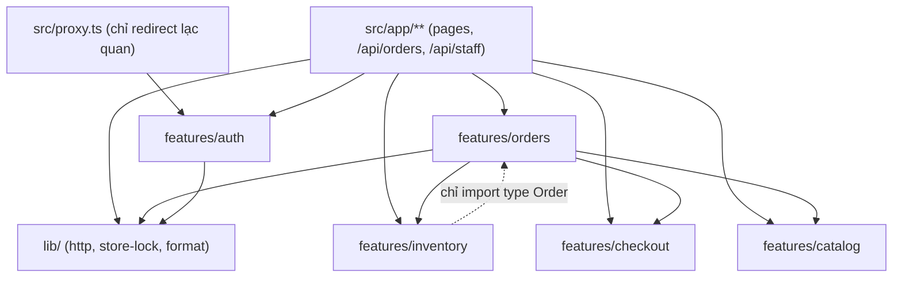
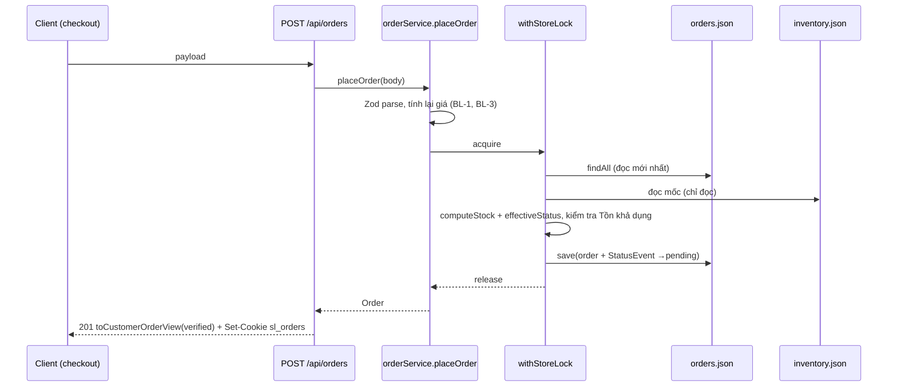
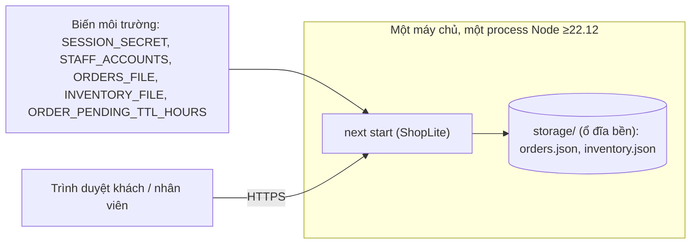

  ---
name: "ShopLite — Vận hành đơn hàng"
type: architecture-spine
purpose: build-substrate
altitude: feature
paradigm: "Modular monolith theo feature + ports-and-adapters gọn"
scope: "Tính năng vận hành đơn hàng trên ShopLite đang chạy: tài khoản nhân viên, quyền xem đơn của khách, vòng đời đơn, giữ hàng và tồn khả dụng, lịch sử trạng thái, Timeline"
status: final
created: "2026-11-21"
updated: "2026-11-21"
binds: [BL-1..BL-10, FR-1..FR-33]
sources:
  - _bmad-output/planning-artifacts/prds/prd-project_ai-2026-11-21/prd.md
  - _bmad-output/planning-artifacts/prds/prd-project_ai-2026-11-21/addendum.md
  - _bmad-output/planning-artifacts/ux-designs/ux-project_ai-2026-11-21/EXPERIENCE.md
  - _bmad-output/planning-artifacts/ux-designs/ux-project_ai-2026-11-21/DESIGN.md
companions: []
---

# Architecture Spine — ShopLite: Vận hành đơn hàng

## Design Paradigm

**Modular monolith chia theo feature** (Next.js App Router), mỗi feature theo **ports-and-adapters gọn**. Đây là quy ước đang có trong repo, được phê chuẩn chứ không phải tạo mới.

| Tầng            | Thư mục                                            | Được chứa                                                                                       | Không được chứa                   |
| --------------- | -------------------------------------------------- | ----------------------------------------------------------------------------------------------- | --------------------------------- |
| Delivery        | `src/app/**` (page, route handler), `src/proxy.ts` | Đọc request, gọi guard, gọi service, render hoặc trả JSON                                       | Quy tắc nghiệp vụ, đọc ghi file   |
| Application     | `src/features/<f>/*-service.ts`                    | Use case, giữ khóa ghi, gọi hàm thuần và repository                                             | JSX, `Request`/`NextResponse`     |
| Domain (thuần)  | `src/features/<f>/*.ts` không có I/O               | Hàm thuần có test cạnh file: tính tiền, sơ đồ trạng thái, tồn khả dụng, chiếu dữ liệu cho khách | `fs`, `Date.now()`, `process.env` |
| Port và adapter | `src/features/<f>/*-repository.ts`                 | Interface cùng adapter JSON-file và in-memory                                                   | Quy tắc nghiệp vụ                 |
| Composition     | `src/features/<f>/server.ts`                       | Tạo instance service từ biến môi trường                                                         | Logic                             |



Chiều phụ thuộc chỉ đi xuống. `features/*` không bao giờ import `src/app/**`. `catalog` và `checkout` không import `orders`, `inventory`, `auth` hay `storage`. `inventory` được import **type** từ `orders/types` nhưng không import code runtime của `orders`.

## Invariants & Rules

### AD-1 — Quy ước feature và hàm thuần [ADOPTED]

- **Binds:** all
- **Prevents:** logic nghiệp vụ nằm trong route hoặc page; đọc file rải rác; logic không test được.
- **Rule:** Mỗi tính năng là `src/features/<feature>/`, gồm `types.ts`, hàm thuần kèm `*.test.ts` cạnh file, `*-service.ts` tạo bằng factory `create<X>Service(deps)` nhận `repository`, `now`, config qua tham số (theo mẫu `createOrderService`), và `server.ts` để tạo instance. Route handler và page chỉ gọi service hoặc guard. Feature mới của tính năng này: `features/auth`, `features/inventory`. `features/orders` được mở rộng tại chỗ.

### AD-2 — Repository là port duy nhất ra `storage/` [ADOPTED]

- **Binds:** BL-8, FR-19, FR-24, FR-26
- **Prevents:** hai đoạn code ghi cùng một file theo hai cách.
- **Rule:** Chỉ adapter `createJsonFile<X>Repository` được dùng `node:fs` trên `storage/`. Mỗi file có đúng một feature sở hữu: `orders.json` thuộc `features/orders`, `inventory.json` thuộc `features/inventory`. Mọi adapter giữ cách ghi atomic `*.tmp` → `rename` như hiện có, và có bản in-memory cho test. Đường dẫn cấu hình qua biến môi trường (`ORDERS_FILE` [ADOPTED], `INVENTORY_FILE`).

### AD-3 — Một khóa ghi trong process cho toàn bộ `storage/`

- **Binds:** FR-18, FR-20, FR-22, FR-30
- **Prevents:** lost update khi hai khách tranh món cuối, hoặc khi hai nhân viên cùng bấm một đơn.
- **Rule:** `withStoreLock(fn)` trong `src/lib/store-lock.ts` là một chuỗi promise, chỉ có một instance cho cả process. **Mọi** use case đọc → kiểm tra → ghi (đặt đơn, chuyển trạng thái, thêm ghi chú, đặt cờ chuyển khoản) phải chạy trọn bên trong một lần `withStoreLock`, và đọc dữ liệu mới nhất **bên trong** khóa. Chỉ tầng service được lấy khóa. Repository không bao giờ tự lấy khóa (khóa không vào lại được). Thao tác chỉ đọc thì không cần khóa. Thao tác hàng loạt (FR-30) dùng **một** lần `withStoreLock` cho cả lô, và gọi `applyTransition` riêng cho từng đơn.

### AD-4 — Tồn thực tính ra từ đơn; luồng xử lý đơn chỉ ghi `orders.json`

- **Binds:** FR-14, FR-15, FR-19 → FR-23
- **Prevents:** hai nguồn số liệu tồn kho lệch nhau; ghi hai file nửa chừng khi crash.
- **Rule:** `inventory.json` = `{ migratedAt, baselines: { [productId]: { onHand, asOf } } }`. Lần chạy đầu, nếu file chưa có thì tạo từ `Product.stock` với `asOf = migratedAt = now`. Sản phẩm mới thêm vào `products.ts` thì được bổ sung mốc. Công thức:
  - **Tồn thực** = `onHand` − Σ số lượng của sản phẩm trong các đơn có `deliveredAt > asOf`.
  - **Hàng đang giữ** = Σ số lượng trong các đơn có `effectiveStatus ∈ {pending, confirmed, shipping}` (theo AD-6).
  - **Tồn khả dụng** = Tồn thực − Hàng đang giữ.

  Ba con số này **chỉ** được tính bằng hàm thuần `computeStock(baselines, orders, now)` trong `features/inventory`. Không nơi nào lưu chúng. Luồng xử lý đơn không bao giờ ghi `inventory.json`. Chỉ thao tác đặt mốc (nhập kho, ngoài phạm vi MVP) mới ghi file này. `migratedAt` được ghi một lần và không bao giờ đổi.

### AD-5 — Sơ đồ trạng thái là một hàm thuần duy nhất

- **Binds:** FR-8, FR-11 → FR-17, FR-24
- **Prevents:** hai endpoint mỗi bên tự đổi `status` theo quy tắc riêng; sự kiện trạng thái thiếu người thao tác.
- **Rule:** `applyTransition(order, to, actor, reason, now): Order` trong `features/orders/order-state.ts` là **chỗ duy nhất** được gán `Order.status`. Hàm này kiểm tra theo bảng FR-11, bắt buộc Lý do khi chuyển sang `cancelled`/`failed`, thêm đúng một `StatusEvent`, cập nhật `updatedAt`, và đặt `deliveredAt` khi sang `delivered`. Sai quy tắc thì ném `OrderError("INVALID_STATUS_TRANSITION")` (409), hoặc `VALIDATION_ERROR` (400) khi thiếu Lý do. Cả việc khách hủy (`cancelOrder` [ADOPTED], giữ BL-4) lẫn nhân viên chuyển trạng thái đều đi qua hàm này.

### AD-6 — Quá hạn xác nhận được tính khi đọc, theo cách xác định

- **Binds:** FR-17, FR-26, SM-2
- **Prevents:** cần tiến trình chạy nền; hai lần ghi bù cho cùng một đơn quá hạn ra hai kết quả khác nhau.
- **Rule:** Hàm thuần `effectiveStatus(order, now, ttlHours, migratedAt)` được áp dụng cho **mọi** lần đọc (danh sách, chi tiết, tính tồn kho). Mốc bắt đầu tính hạn là `createdAt`; với đơn không có `history` (đơn cũ) thì lấy `max(createdAt, migratedAt)`. Đơn quá hạn được ghi bù thành `cancelled` ở **lần ghi đầu tiên chạm tới đơn đó**, qua `applyTransition` với actor `system`, Lý do "Quá hạn xác nhận", và thời điểm sự kiện = mốc bắt đầu + TTL (không phải thời điểm phát hiện). `ORDER_PENDING_TTL_HOURS` mặc định là 24.

### AD-7 — Định dạng dữ liệu `Order` chỉ được mở rộng thêm

- **Binds:** BL-7, BL-8, FR-10, FR-24 → FR-26, FR-32
- **Prevents:** đơn cũ không đọc được; hai feature định nghĩa `StatusEvent` hoặc `Actor` theo hai cách.
- **Rule:** `features/orders/types.ts` sở hữu các kiểu sau:
  - `OrderStatus` thêm giá trị `failed`.
  - `Actor = { kind: "staff"; username: string } | { kind: "customer" } | { kind: "system" }`.
  - `StatusEvent = { from: OrderStatus | null; to; at; actor; reason? }`.
  - `InternalNote = { at; author: string; text }`.
  - `Order` thêm `history?`, `notes?`, `deliveredAt?`, `payment?: { received: boolean; ref?: string }`.

  Mọi field mới là **optional**. Không xóa hay đổi tên field hiện có. `Actor.username` và `InternalNote.author` lưu **username**, không lưu tên hiển thị. Tên hiển thị được tra ở lúc render (xem Consistency Conventions). Ghi chú và cờ chuyển khoản không đổi `status`, nên không đi qua `applyTransition`. Chúng được thêm bằng hàm thuần `appendNote(order, author, text, now)` trong `order-state.ts`; FR-32 dùng chính hàm này để ghi lại mỗi lần đổi cờ. Thời điểm là chuỗi ISO-8601 UTC. Phía server tính lại giá theo BL-1, dùng `calculateOrderTotals` [ADOPTED].

### AD-8 — Khách chỉ nhận dữ liệu đã qua hàm chiếu

- **Binds:** FR-3 → FR-6, FR-27, FR-28, SM-1
- **Prevents:** lộ dữ liệu cá nhân hoặc Ghi chú nội bộ khi một page hay endpoint trả thẳng `Order`.
- **Rule:** Mọi bề mặt dành cho khách (`/orders`, `/orders/[id]`, `GET /api/orders/:id`, phản hồi của `POST`/`PATCH /api/orders`) chỉ trả kết quả của `toCustomerOrderView(order, { verified }, now)` trong `features/orders/customer-view.ts`. Hàm này luôn bỏ `notes` và `payment.ref`. Nó đổi actor `staff` thành "Cửa hàng". Khi `verified=false`, nó bỏ `fullName`, `email`, `address`, `note` và chỉ trả `phone` đã che. Chỉ handler dưới `/api/staff/**` và page dưới `/staff/**` được trả nguyên `Order`.

### AD-9 — Xác thực: cookie ký bằng `node:crypto`; kiểm tra thật ở DAL

- **Binds:** FR-1, FR-2, FR-5 → FR-8
- **Prevents:** chỉ dựa vào proxy để phân quyền; mỗi endpoint tự kiểm tra một kiểu; thêm thư viện auth.
- **Rule:** `features/auth` sở hữu:
  - **Cookie phiên `sl_staff`:** `{ username, exp }`, ký HMAC-SHA256 bằng `SESSION_SECRET`, hết hạn sau 12 giờ.
  - **Cookie xác minh đơn `sl_orders`:** danh sách Mã đơn đã xác minh, ký HMAC-SHA256, giữ tối đa 20 mã gần nhất.
  - Cả hai đều `HttpOnly`, `SameSite=Lax`, và `Secure` khi `NODE_ENV=production`.
  - **Danh sách nhân viên:** biến môi trường `STAFF_ACCOUNTS` (JSON `[{ username, displayName, passwordHash }]`), băm bằng `scrypt`. So khớp chuỗi bằng `timingSafeEqual`.

  Mỗi handler hoặc page có dữ liệu được bảo vệ phải gọi guard của DAL: `requireStaff()` (trả `Actor` hoặc ném `AccessError("UNAUTHENTICATED")` 401), hoặc `canViewOrder(orderId, phone?)`. `src/proxy.ts` chỉ chuyển `/staff/**` (trừ `/staff/login`) về trang login khi thiếu cookie, **không** thay cho guard. Không thêm dependency.

### AD-10 — Lỗi có chung một định dạng; mỗi feature có loại lỗi riêng [ADOPTED + mở rộng]

- **Binds:** BL-5, FR-2, FR-7, FR-8, FR-18
- **Prevents:** endpoint mới tự chế định dạng lỗi; mã lỗi auth lẫn vào `OrderError`.
- **Rule:** Lỗi nghiệp vụ luôn được ném, rồi `handleRouteError` (`src/lib/http.ts`) đổi thành `{ error: { code, message, details? } }`.
  - `OrderError` giữ nguyên các mã và HTTP status hiện có.
  - `AccessError` (trong `features/auth`): `UNAUTHENTICATED` 401, `FORBIDDEN` 403, `TOO_MANY_ATTEMPTS` 429. Có cùng getter `httpStatus` như `OrderError`.
  - `handleRouteError` nhận cả hai loại. Lỗi khác thì trả 500 `INTERNAL_ERROR`.
  - Lỗi 409 do xung đột (FR-18) đưa trạng thái hiện tại và người thao tác cuối vào `details`.

### AD-11 — Input validate bằng Zod, thao tác ghi đi qua Route Handler [ADOPTED]

- **Binds:** BL-3, FR-1, FR-6, FR-10, FR-12 → FR-16, FR-30, FR-32, FR-33
- **Prevents:** một nửa thao tác ghi dùng Server Actions, nửa kia dùng API; input không được kiểm tra.
- **Rule:** Mọi body hoặc query từ client được parse bằng một Zod schema đặt trong `features/<f>/*-schema.ts`, rồi đổi lỗi qua `toFieldErrors` [ADOPTED]. Mọi thao tác ghi là Route Handler. Client component gọi bằng `fetch`, theo mẫu `CancelOrderButton`. **Không dùng Server Actions.** Các endpoint mới:
  - `POST /api/staff/login`, `POST /api/staff/logout`
  - `POST /api/staff/orders/:id/transitions` `{ to, reason? }`
  - `POST /api/staff/orders/transitions` (nhiều đơn, Should)
  - `POST /api/staff/orders/:id/notes`, `PUT /api/staff/orders/:id/payment`
  - `GET /api/staff/orders?status=&q=`
  - `POST /api/orders/:id/verify` `{ phone }`

  `PATCH /api/orders/:id` `{ "status": "cancelled" }` giữ nguyên contract, chỉ thêm guard.

### AD-12 — Catalog giữ thuần; tồn khả dụng được truyền vào

- **Binds:** FR-23, BL-10
- **Prevents:** catalog chuyển sang async và tự đọc file; mỗi trang tính "còn hàng" một kiểu.
- **Rule:** Các hàm của `catalog-service` dùng tồn kho (`getStockStatus`, bộ lọc `inStock`, tìm kiếm) nhận thêm `availability: ReadonlyMap<productId, number>` qua tham số, **mặc định là `Product.stock`** để test cũ vẫn chạy. Page phía server lấy map này từ `inventoryService.getAvailability(now)`. Giỏ hàng nhận `stock` = Tồn khả dụng qua props lúc thêm hàng. Không có "tồn" nào khác được hiển thị cho khách. `GET /api/products` và `GET /api/products/:slug` trả `stock` = Tồn khả dụng. Mọi page hiển thị tồn kho phải render theo từng request (`export const dynamic = "force-dynamic"`, như các trang `orders` [ADOPTED]). `/products/[slug]` bỏ `generateStaticParams`, vì nếu không thì tồn kho bị đóng băng từ lúc build.

### AD-13 — Giới hạn tra sai lưu trong bộ nhớ

- **Binds:** FR-7, SM-C3
- **Prevents:** mỗi endpoint tra cứu tự đếm số lần sai theo một cách.
- **Rule:** `features/auth/attempt-limiter.ts` là module duy nhất đếm số lần tra sai. Nó có hai `Map` trong bộ nhớ: một theo Mã đơn (5 lần trong 15 phút), một theo nguồn yêu cầu (20 lần trong 15 phút; khóa theo IP lấy từ `x-forwarded-for` hoặc địa chỉ socket). Thiết bị đã đặt và phiên nhân viên được miễn. Khởi động lại thì bộ đếm reset, chấp nhận vì chỉ chạy một instance.

### AD-14 — Triển khai: một instance Node, `storage/` là dữ liệu bền

- **Binds:** all (môi trường vận hành)
- **Prevents:** chạy nhiều replica làm hỏng AD-3 và AD-13; commit nhầm dữ liệu khách.
- **Rule:** Chỉ chạy `next start` trên **đúng một** process Node ≥ 22.12, với `storage/` nằm trên ổ đĩa bền. Thêm `storage/` vào `.gitignore` (hiện đang thiếu, dù README nói đã có). Thiếu `SESSION_SECRET` hoặc `STAFF_ACCOUNTS` thì `/staff/login` từ chối mọi lần đăng nhập và ghi log lỗi. **Không** có giá trị mặc định viết cứng. README liệt kê đủ các biến môi trường mới và ràng buộc chạy một instance.

## Consistency Conventions

| Concern                     | Convention                                                                                                                                                                               |
| --------------------------- | ---------------------------------------------------------------------------------------------------------------------------------------------------------------------------------------- |
| Đặt tên file                | kebab-case: `*-service.ts`, `*-repository.ts`, `*-schema.ts`, `*-errors.ts`, test cùng tên `*.test.ts`. Component `kebab-case.tsx` trong `features/<f>/components/`                      |
| Mã đơn                      | `SL-YYYYMMDD-XXXXXX` (`generateOrderId` [ADOPTED]). Tìm theo 6 ký tự cuối, không phân biệt hoa thường                                                                                    |
| Thời gian                   | Lưu ISO-8601 UTC. Hiển thị qua `formatDateTime` (`lib/format.ts`). Mọi service nhận `now: () => Date` để test được                                                                       |
| SĐT                         | Chuẩn hóa `+84…` thành `0…` trước khi so khớp hoặc che. Che theo dạng `09****678`                                                                                                        |
| Mã lỗi                      | `UPPER_SNAKE_CASE`. Câu thông báo bằng tiếng Việt, viết cho người dùng cuối đọc                                                                                                          |
| Cookie                      | `sl_staff`, `sl_orders`. Không tạo cookie nào khác cho tính năng này                                                                                                                     |
| Biến môi trường             | `ORDERS_FILE` [ADOPTED], `INVENTORY_FILE`, `SESSION_SECRET`, `STAFF_ACCOUNTS`, `ORDER_PENDING_TTL_HOURS`. Chỉ đọc trong `server.ts` của feature                                          |
| Tên hiển thị người thao tác | Nhân viên xem: `displayName`. Khách xem: "Cửa hàng" (AD-8). Hệ thống: "Hệ thống". Đơn cũ thiếu actor: "Không rõ"                                                                         |
| Logging                     | `console.error` cho lỗi 500 [ADOPTED]. Không log SĐT, địa chỉ, mật khẩu hay cookie                                                                                                       |
| Test                        | Hàm thuần có unit test. Service test bằng in-memory repo + `now` cố định. Route test như `route.test.ts` hiện có. E2E Playwright cho UJ-1 → UJ-4 dùng `ORDERS_FILE`/`INVENTORY_FILE` tạm |

## Stack

| Name                                   | Version                  |
| -------------------------------------- | ------------------------ |
| Node.js                                | ≥ 22.12.0                |
| Next.js (App Router, `proxy.ts`)       | 16.4.2                   |
| React / React DOM                      | 19.3.0                   |
| TypeScript                             | ^5                       |
| Zod                                    | ^4.6.7                   |
| Tailwind CSS                           | ^4                       |
| lucide-react                           | ^1.61.0                  |
| Vitest                                 | ^5.0.5                   |
| Playwright                             | ^1.64.1                  |
| Crypto (HMAC, scrypt, timingSafeEqual) | `node:crypto` (built-in) |

## Structural Seed

```text
src/
  proxy.ts                      # MỚI: chỉ redirect lạc quan /staff/** (AD-9)
  lib/
    http.ts                     # handleRouteError nhận OrderError + AccessError (AD-10)
    store-lock.ts               # MỚI: withStoreLock (AD-3)
  features/
    auth/                       # MỚI
      staff-accounts.ts         # đọc và kiểm tra STAFF_ACCOUNTS, scrypt
      session.ts                # ký và kiểm tra sl_staff, sl_orders
      guards.ts                 # requireStaff(), canViewOrder()
      attempt-limiter.ts        # AD-13
      access-errors.ts
    inventory/                  # MỚI
      compute-stock.ts          # computeStock, hàm thuần (AD-4)
      inventory-repository.ts   # mốc, JSON + in-memory
      inventory-service.ts      # getAvailability(now)
      server.ts
    orders/                     # MỞ RỘNG
      types.ts                  # + failed, Actor, StatusEvent, InternalNote (AD-7)
      order-state.ts            # applyTransition, effectiveStatus (AD-5, AD-6)
      customer-view.ts          # toCustomerOrderView (AD-8)
      order-service.ts          # placeOrder dùng tồn khả dụng; transition; notes; payment
      staff-order-schema.ts
    catalog/                    # SỬA: nhận availability (AD-12)
  app/
    orders/ ...                 # dùng customer-view
    staff/login/  staff/  staff/orders/[id]/  staff/orders/[id]/print/
    api/orders/[id]/verify/
    api/staff/login/  logout/  orders/  orders/[id]/transitions/  notes/  payment/
storage/                        # gitignore (AD-14): orders.json, inventory.json
```





## Capability → Architecture Map

| Capability / Area                          | Lives in                                                                                            | Governed by                    |
| ------------------------------------------ | --------------------------------------------------------------------------------------------------- | ------------------------------ |
| BL-1 → BL-10 (giữ nguyên)                  | `features/checkout`, `features/orders`, `lib/http.ts`, `features/cart`                              | AD-1, AD-2, AD-7, AD-10, AD-11 |
| FR-1, FR-2 Đăng nhập, bảo vệ `/staff`      | `features/auth`, `src/proxy.ts`, `app/staff/login`, `app/api/staff/login`                           | AD-9, AD-10, AD-14             |
| FR-3 → FR-8 Quyền xem và hủy của khách     | `features/auth/guards.ts`, `features/orders/customer-view.ts`, `app/orders/**`, `app/api/orders/**` | AD-8, AD-9, AD-13, AD-5        |
| FR-9, FR-10, FR-33 Hàng đợi, chi tiết, tìm | `app/staff/**`, `GET /api/staff/orders`                                                             | AD-6, AD-9, AD-11              |
| FR-11 → FR-18 Vòng đời, xung đột           | `features/orders/order-state.ts`, `order-service.ts`                                                | AD-3, AD-5, AD-6, AD-10        |
| FR-19 → FR-23 Tồn kho                      | `features/inventory`, `features/catalog` (tham số)                                                  | AD-3, AD-4, AD-12              |
| FR-24 → FR-26 Lịch sử, đơn cũ              | `features/orders/types.ts`, `order-state.ts`                                                        | AD-5, AD-6, AD-7               |
| FR-27 → FR-29 Timeline, thông điệp         | `features/orders/customer-view.ts`, `app/orders/[id]`                                               | AD-8                           |
| FR-30 → FR-32 (Should)                     | `app/api/staff/**`, `app/staff/orders/[id]/print`                                                   | AD-3, AD-5, AD-11              |
| NFR bảo mật, toàn vẹn, chạy một instance   | toàn hệ thống                                                                                       | AD-3, AD-9, AD-14              |

## Deferred

- **Nhập kho và điều chỉnh tồn** (Câu hỏi mở 1 của PRD): mô hình đã sẵn (ghi mốc mới `{ onHand, asOf }` vào `inventory.json` qua `withStoreLock`), nhưng chưa có giao diện hay endpoint. Xem lại trước khi đo SM-5.
- **Chạy nhiều instance hoặc dùng database:** AD-2 giữ repository làm port để sau này thay adapter. Khóa liên process và bộ đếm tra sai dùng chung sẽ được quyết khi rời mô hình một instance.
- **Kiểm tra schema khi đọc file JSON:** hiện adapter cast kiểu như code cũ. Thêm Zod parse ở ranh giới repository nếu dữ liệu bắt đầu có nhiều phiên bản.
- **Sao lưu `storage/`, giám sát, metrics:** ngoài phạm vi MVP. Logging giữ `console.error`.
- **Xoay vòng `SESSION_SECRET`, đổi mật khẩu:** đổi biến môi trường rồi khởi động lại, mọi phiên bị hủy. Chưa cần cơ chế xoay vòng.
- **CSS in phiếu, chi tiết component UI:** thuộc UX spine (`EXPERIENCE.md`, `DESIGN.md`) và code.
