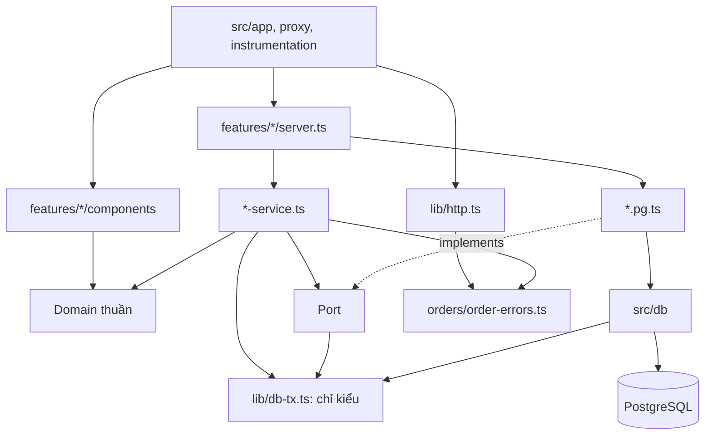
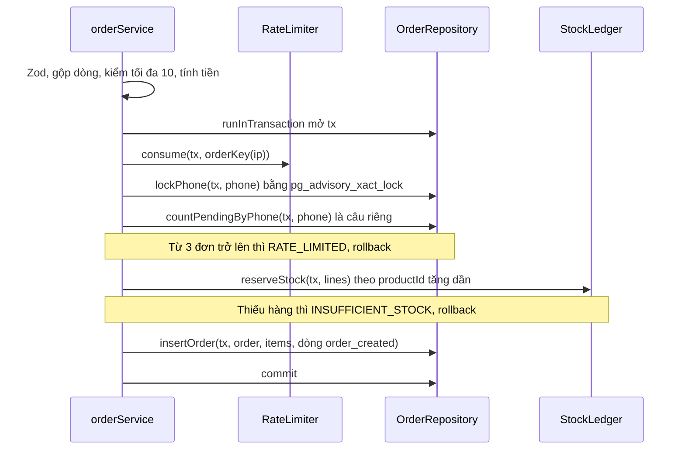
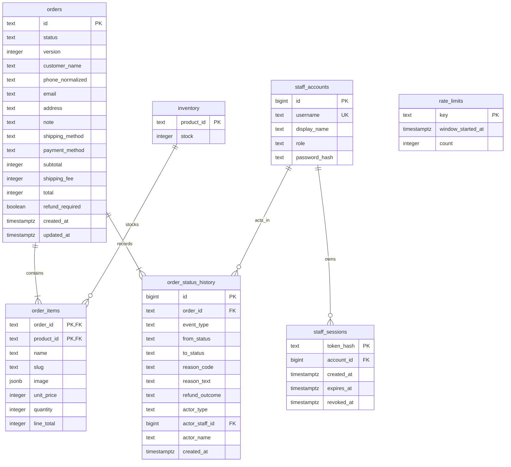
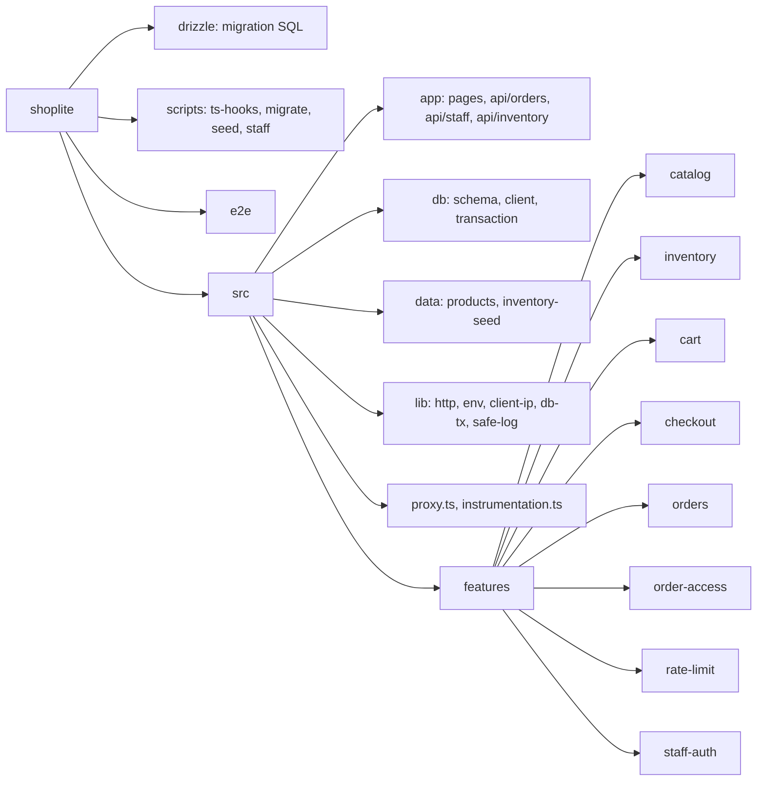

# Architecture Spine — shoplite

## Design Paradigm

**Feature-based modular monolith, Ports and Adapters ở biên dữ liệu.** Một ứng dụng Next.js, một PostgreSQL. Quy tắc nghiệp vụ là hàm thuần; service điều phối và mở transaction qua port; adapter PostgreSQL là nơi duy nhất chạm SQL.

| Lớp | Thư mục | Được làm |
| --- | --- | --- |
| Delivery | `src/app/**`, `src/proxy.ts`, `src/instrumentation.ts` | Nhận request, gọi guard và service, trả response hoặc render |
| Layout | `src/components/layout/` | Khung cửa hàng; được import hằng số và component của feature, không import adapter |
| UI feature | `src/features/<feature>/components/` | Hiển thị, gọi API; không import adapter |
| Domain thuần | `src/features/<feature>/*.ts`, test cạnh file | Không I/O, không `process.env`; client import được. `catalog-service.ts` thuộc lớp này dù có hậu tố `-service` |
| Application | `src/features/<feature>/*-service.ts` | Zod parse, mở transaction qua `RunInTransaction`, ném `OrderError` |
| Port | `*-repository.ts`, `inventory/stock-ledger.ts`, `rate-limit/rate-limiter.ts` | Interface async |
| Adapter | `src/features/<feature>/*.pg.ts`, `src/db/` | SQL, Drizzle |
| Composition | `src/features/<feature>/server.ts` | Singleton nối service với adapter; chỉ code server import |
| Shared | `src/lib/`, `src/data/`, `src/components/ui/` | Tiện ích và dữ liệu tĩnh; `src/data` được `import type` từ feature |



## Invariants & Rules

### AD-1 — Feature-based và hướng phụ thuộc [ADOPTED]

- **Binds:** all
- **Prevents:** Logic nghiệp vụ nằm trong route/page; bundle client kéo theo `pg`.
- **Rule:** Mũi tên phụ thuộc theo sơ đồ trên. `src/app/**` không chứa SQL, không import `src/db` hay `*.pg.ts`. File có `"use client"` và mọi file nó import không được import `src/db`, `*.pg.ts`, `server.ts`. `lib/http.ts` → `orders/order-errors.ts` là phụ thuộc runtime ngược duy nhất từ `lib` vào feature; `order-errors.ts` không import gì. `server.ts`, `*.pg.ts`, `src/db/**`, `lib/env.ts` mở đầu bằng `import "server-only"`. ESLint thực thi bằng `no-restricted-imports` cho `src/app/**` và `**/components/**`, và `no-restricted-syntax` cho `process.env` theo AD-31.

### AD-2 — Repository async và DI [ADOPTED]

- **Binds:** FR-1..FR-21
- **Prevents:** Route truy cập storage trực tiếp; đường ghi đè toàn bộ đơn.
- **Rule:** Service nhận port và `runInTransaction` qua `createOrderService(deps)`; singleton chỉ ở `features/orders/server.ts`. Route chỉ gọi service. `OrderRepository.save`, `createJsonFileOrderRepository`, `createInMemoryOrderRepository`, `DEFAULT_ORDERS_FILE`, `ORDERS_FILE` bị xóa. App không đọc, không ghi, không xóa `storage/orders.json`; 11 đơn thử không được chuyển.

### AD-3 — OrderError, lỗi đã làm sạch và log an toàn [ADOPTED]

- **Binds:** FR-1, FR-3, FR-4, FR-8, FR-10, FR-12, FR-13, FR-19, FR-20, FR-21, NFR Bảo mật
- **Prevents:** Mỗi route tự đặt dạng lỗi; tham số SQL, số điện thoại, địa chỉ lọt vào log qua route hoặc Server Component.
- **Rule:** Mọi route API bọc bằng `handleRouteError`, trả `{ error: { code, message, details? } }`. Mã thêm vào `OrderErrorCode`: `UNAUTHORIZED` 401, `FORBIDDEN` 403, `RATE_LIMITED` 429, `LOOKUP_FAILED` 404, `REFUND_OUTCOME_CONFLICT` 409; mã cũ giữ nguyên HTTP; không tạo class lỗi nghiệp vụ thứ hai. `order-errors.ts` export `FieldErrorDetails = Record<string, string>`, `InsufficientStockDetails = { lines: { productId: string; requested: number; available: number }[] }`, `OrderErrorDetails` là hợp của hai kiểu; `OrderError.details`, `ApiErrorBody`, `jsonError` dùng kiểu hợp này. Client chỉ đọc `details.lines` sau khi kiểm `code === "INSUFFICIENT_STOCK"`.
- **Rule (làm sạch):** Mọi truy vấn chạy trong `runInTransaction` hoặc `withDb` của `src/db/transaction.ts`. Hai hàm này bắt lỗi driver/Drizzle và ném lại `DbFailure` chỉ có `sqlState`, message cố định `Database operation failed`, không có `cause`, không giữ `message`/`stack` gốc; `OrderError` đi qua nguyên vẹn. Vì Next tự log lỗi Server Component kèm message, không có lỗi DB thô nào được phép thoát khỏi adapter. Pool có `on("error")` chỉ log `sqlState`.
- **Rule (log):** `lib/safe-log.ts#logServerError(scope, error)` là đường log lỗi server duy nhất, chỉ ghi `scope`, `name`, `code` hoặc `sqlState`; không ghi `message`, `stack`, object lỗi, body, cookie, số điện thoại, địa chỉ. `console.error(error)` trong `lib/http.ts` bị xóa. Message của `OrderError` không chứa dữ liệu khách.

### AD-6 — Drizzle với node-postgres, có cổng spike

- **Binds:** FR-10, FR-12, FR-16, FR-17, FR-20
- **Prevents:** Build toàn bộ trên ORM chưa chạy được với bản Next đã chốt.
- **Rule:** Story đầu tiên nâng `next` và `eslint-config-next` lên đúng 16.4.6, đặt `engines.node` thành `>=22.18.0`, rồi merge một spike chạy thật: một đơn trừ kho qua route handler, dùng đúng `runInTransaction` và `DbTx` của AD-10. Chưa đạt thì chưa story nào khác được phụ thuộc vào Drizzle. Pool `pg` là singleton lazy trên `globalThis` trong `src/db/client.ts`; không kết nối lúc import. Transaction dùng READ COMMITTED. `drizzle-orm` và `drizzle-kit` pin chính xác và nâng cùng nhau.

### AD-8 — Máy trạng thái thuần và một đường ghi Trạng thái

- **Binds:** FR-10, FR-11, FR-12, FR-13, FR-14, FR-17, FR-21
- **Prevents:** Hai người cùng thắng; ABA sau Lùi đơn; thao tác từ màn hình cũ; Trạng thái lệch Lịch sử; cờ hoàn tiền không có chủ ghi.
- **Rule (quyết định):** `features/orders/order-state-machine.ts` export `decideTransition({ from, to, role, paymentMethod, reasonCode, reasonText })`, không I/O, trả lỗi hoặc `{ restoreStock, setRefundRequired }`. Chỉ các cạnh trong bảng chuyển trạng thái của EXPERIENCE là hợp lệ. Thứ tự kiểm: sai vai → `FORBIDDEN` (xét theo cạnh `from`/`to` mà request gửi, nên Nhân viên gọi Lùi đơn luôn nhận 403 dù đơn không ở Đã giao); cạnh sai → `INVALID_STATUS_TRANSITION`; lý do sai → `VALIDATION_ERROR`. Cạnh tiến không nhận lý do; cạnh Hủy chỉ nhận `CANCEL_REASONS`; cạnh Lùi chỉ nhận `REVERT_REASONS` (`features/orders/order-reasons.ts`, kèm nhãn tiếng Việt). `other` bắt buộc có chữ sau `trim`, tối đa 200 ký tự đếm bằng `.length` JavaScript sau `trim` (cùng đơn vị với `maxlength`); mã khác gửi kèm chữ là `VALIDATION_ERROR`. `restoreStock = reasonCode !== "out_of_stock"` trên cạnh Hủy, `false` ở cạnh khác. `setRefundRequired = paymentMethod === "bank_transfer"` trên cạnh Hủy. Test phủ toàn bộ tích `from × to × role`. Xác nhận hai lần của FR-11 là việc của UI.
- **Rule (đường ghi):** Sau khi tạo đơn, `orders.status`, `version`, `updated_at`, `refund_required` chỉ được ghi bởi `casOrderStatus` trong `order-repository.pg.ts`, trong **một câu UPDATE**, và hàm đó chỉ được gọi từ `orderService.transitionOrder`. `PATCH /api/staff/orders/:id` gửi `from` và `expectedVersion` lấy từ `StaffOrderDetail`. Trong một transaction: (1) câu riêng `SELECT ... FOR UPDATE` dòng `orders`, không có thì `ORDER_NOT_FOUND`; (2) `decideTransition` với `from` của request; (3) `status ≠ from` hoặc `version ≠ expectedVersion` thì `INVALID_STATUS_TRANSITION`; (4) `UPDATE orders SET status = $to, version = version + 1, updated_at = clock_timestamp(), refund_required = refund_required OR $setRefund WHERE id = $id AND status = $from AND version = $expectedVersion RETURNING ...`, 0 dòng thì `INVALID_STATUS_TRANSITION`; (5) hoàn kho nếu có; (6) ghi một dòng Lịch sử. Bên thua không để lại dòng nào; UI hiện `Đơn vừa được người khác cập nhật`.
- **Rule (bất biến cột):** `version integer NOT NULL DEFAULT 0`, chỉ tăng khi đổi Trạng thái; ghi kết quả hoàn tiền không tăng `version`, không đổi `updated_at`. `refund_required` chỉ bật trên cạnh Hủy và không bao giờ tắt; đơn rời tab Cần hoàn tiền là suy ra từ Lịch sử. `CHECK (NOT refund_required OR (status = 'cancelled' AND payment_method = 'bank_transfer'))`. Không dùng `updated_at` làm token chống cũ.

### AD-9 — Một đường ghi Tồn kho, hoàn đúng một lần

- **Binds:** FR-12, FR-16, FR-17, FR-19, SM-2
- **Prevents:** Bán quá tồn, hoàn hai lần, hoàn một phần đơn `out_of_stock`, deadlock, khách sửa từng dòng thiếu một.
- **Rule:** Trong app, `inventory.stock` chỉ được ghi bởi `reserveStock(tx, lines)` và `restoreStock(tx, lines)` trong `features/inventory/stock-ledger.pg.ts`. Trừ kho là `UPDATE inventory SET stock = stock - $n WHERE product_id = $id AND stock >= $n`. Mọi cập nhật nhiều sản phẩm chạy tuần tự theo `productId` tăng dần (so sánh code unit). `restoreStock` chỉ được gọi sau khi `casOrderStatus` thắng trên cạnh Hủy và quyết định có `restoreStock = true`; với `out_of_stock` không dòng tồn kho nào của đơn được cập nhật. Dòng hoàn kho ảnh hưởng 0 hàng thì ném lỗi để rollback. `CHECK (stock >= 0)`. Sửa tay trong database là ngoại lệ PRD 6.3 đã chấp nhận.
- **Rule (thiếu hàng):** `reserveStock` đi hết mọi dòng, không dừng ở dòng thiếu đầu tiên. Dòng thiếu đọc `stock` bằng câu riêng (không có hàng `inventory` tính là 0) và báo `available = max(0, min(stockĐọcĐược, requested - 1))`, vì hoàn kho có thể commit xen giữa. Hết vòng, nếu có dòng thiếu thì ném `INSUFFICIENT_STOCK` với `details.lines` để rollback.

### AD-10 — Hợp đồng transaction xuyên feature và thứ tự khóa

- **Binds:** FR-3, FR-8, FR-10, FR-12, FR-16, FR-17, FR-19, FR-20, FR-21
- **Prevents:** Ba feature dùng ba kiểu handle; vượt 3 đơn chờ; deadlock; đơn thất bại vẫn bị đếm; đọc snapshot cũ sau khi chờ khóa.
- **Rule (kiểu):** `src/lib/db-tx.ts` chỉ chứa kiểu: `DbTx` là branded opaque type, `RunInTransaction = <T>(fn: (tx: DbTx) => Promise<T>) => Promise<T>`. `src/db/transaction.ts` cài `runInTransaction`, `withDb` và `toDrizzleTx(tx)`; chỉ `*.pg.ts` được gọi `toDrizzleTx`. Service không import Drizzle hay `pg`.
- **Rule (ai mở):** Chỉ service của use case mở transaction, đúng một lần, ở ngoài cùng, không lồng. Adapter không tự mở. Mọi hàm port ghi, và mọi hàm đọc dùng để quyết định sau khi lấy khóa, nhận `tx: DbTx` là **tham số đầu, bắt buộc**. Đọc chỉ để hiển thị không nhận `tx`. Không chạy scrypt, gọi mạng hay việc chậm trong transaction. Không tự retry khi lỗi DB.
- **Rule (ghép `placeOrder`):** `orderService` nhận `runInTransaction`, `OrderRepository`, `StockLedger`, `RateLimiter` qua deps; `orders/server.ts` nối adapter. Zod, gộp dòng và tính tiền xong trước khi mở transaction. Trong transaction, theo đúng thứ tự ở sơ đồ dưới. Mọi lỗi rollback toàn bộ, kể cả bộ đếm IP, nên chỉ đơn thành công được đếm.
- **Rule (snapshot):** Ở READ COMMITTED, mọi lần đọc dùng để quyết định sau khi lấy khóa **phải là câu lệnh riêng, chạy sau câu lấy khóa**. Cấm gộp khóa và đọc bằng subquery, CTE hay một câu `SELECT ... FOR UPDATE` có subquery đọc dữ liệu quyết định. Áp dụng cho advisory lock → đếm `pending` và khóa `orders` → đọc kết quả hoàn tiền mới nhất. Race test của hai đường này là bắt buộc.
- **Rule (thứ tự khóa toàn hệ thống):** (1) `rate_limits` theo `key` tăng dần → (2) advisory lock theo SĐT → (3) dòng `orders` → (4) `inventory` theo `productId` tăng dần. Đường có thể bỏ bước nhưng không đảo thứ tự. `placeOrder` dùng 1, 2, 4; chuyển trạng thái dùng 3, 4; hoàn tiền chỉ dùng 3.



### AD-12 — Lịch sử append-only có event_type

- **Binds:** FR-7, FR-14, FR-15, FR-21, SM-3
- **Prevents:** Sửa dấu vết; dòng hoàn tiền bị hiểu là đổi Trạng thái; tên khách bị chép vào bảng không sửa được; thứ tự "mới nhất" sai.
- **Rule:** `order_status_history.event_type` thuộc `order_created`, `status_changed`, `refund_outcome_recorded`. CHECK theo loại: `order_created` có `from_status NULL`, `to_status = 'pending'`, `reason_code`, `reason_text`, `refund_outcome` NULL, `actor_type = 'customer'`, `actor_staff_id NULL`, `actor_name = 'Khách hàng'`; `status_changed` bắt buộc `from_status`, `to_status`, `refund_outcome NULL`, `actor_type = 'staff'`; `refund_outcome_recorded` bắt buộc `refund_outcome`, `from_status`, `to_status`, `reason_code` NULL, lý do đính chính ở `reason_text`, `actor_type = 'staff'`. `actor_type` thuộc `customer`, `staff`; dòng `staff` bắt buộc `actor_staff_id` và bản chụp `actor_name`. Trigger `BEFORE UPDATE OR DELETE` từ chối mọi sửa, xóa; trigger nằm trong custom migration (`drizzle-kit generate --custom`) và có test khẳng định tồn tại sau `db:migrate`. Code không có hàm hoặc API sửa, xóa Lịch sử.
- **Rule (thứ tự):** `created_at` do database cấp bằng `clock_timestamp()`. Thứ tự chuẩn trong một đơn là `id`, vì dòng được chèn khi đang giữ khóa `orders`. Mốc khách chỉ đọc dòng `status_changed`, theo Ghi chú cho story FR-7.

### AD-14 — Kết quả hoàn tiền chỉ hợp lệ theo kết quả mới nhất

- **Binds:** FR-14, FR-15, FR-21
- **Prevents:** Ghi trùng; lưu ngầm trạng thái thanh toán; đơn quay lại tab Cần hoàn tiền; thiếu lý do bị báo nhầm là xung đột.
- **Rule:** `orders` có `payment_method` (phương thức khách chọn lúc đặt) và `refund_required`, **không** có cột `payment_status` hay cột kết quả hoàn tiền; kết quả mới nhất luôn suy ra từ Lịch sử qua một helper duy nhất `findLatestRefundOutcome(tx, orderId)`, đọc `ORDER BY id DESC LIMIT 1`. Mã kết quả: `refunded`, `customer_not_transferred`. Hàm thuần `decideRefundOutcome({ latest, requested, reasonText })` trong `features/orders/refund-outcomes.ts` chỉ cho phép: chưa có → một trong hai; `customer_not_transferred` → `refunded`; `refunded` → `customer_not_transferred` và bắt buộc lý do. Chỉ đính chính mới có chữ, tối đa 200 ký tự.
- **Rule (đường ghi):** `POST /api/staff/orders/:id/refund-outcomes`, chỉ vai `manager`. Trong một transaction: (1) câu riêng `SELECT ... FOR UPDATE` dòng `orders`; (2) kiểm `status = cancelled` và `refund_required`; (3) câu riêng đọc kết quả mới nhất; (4) so với `expectedLatest`; (5) quyết định; (6) insert dòng Lịch sử. Lỗi: body sai hoặc thiếu lý do đính chính là `VALIDATION_ERROR` (giữ hộp thoại); không có đơn là `ORDER_NOT_FOUND`; sai điều kiện ở bước 2, lệch `expectedLatest` hoặc chuyển kết quả không hợp lệ là `REFUND_OUTCOME_CONFLICT`. Bên thua không để lại dòng.

### AD-16 — Xác thực nhân viên: tài khoản, scrypt, phiên có thu hồi

- **Binds:** FR-8, FR-14
- **Prevents:** Tài khoản dùng chung; mật khẩu rõ trong cấu hình; hash yếu; phiên còn sống sau đăng xuất; lộ database là lộ phiên.
- **Rule (tài khoản):** `staff_accounts` có `username` unique với `CHECK (username = lower(username))`, `display_name`, `role` thuộc `staff`, `manager`, `password_hash`. Không có API tạo hoặc sửa tài khoản. `normalizeUsername = trim + toLowerCase`, dùng ở seed và login; quá 64 ký tự bị từ chối trước `consume`. `npm run staff:seed` upsert từ `STAFF_ACCOUNTS`, JSON array `[{ "username", "displayName", "role", "passwordHash" }]` đặt trong nháy đơn ở `.env`, không chứa mật khẩu rõ. `npm run staff:hash` đọc mật khẩu từ stdin, không nhận qua argv. Seed làm đổi hash thì thu hồi mọi phiên của tài khoản đó.
- **Rule (scrypt):** Dùng `scrypt` bất đồng bộ của `node:crypto` với `N = 32768`, `r = 8`, `p = 3`, `keylen = 32`, salt ngẫu nhiên 16 byte, `maxmem = 67108864`. Lưu dạng `scrypt:32768:8:3:<salt base64url>:<hash base64url>`; không dùng `$` vì Next mở rộng biến trong `.env`. So khớp đọc tham số từ chuỗi hash, parse chặt, kiểm độ dài bằng nhau rồi dùng `timingSafeEqual`. Username không tồn tại vẫn chạy scrypt trên hash giả cùng tham số. Mật khẩu quá 256 ký tự bị từ chối trước scrypt. Toàn bộ nằm trong `features/staff-auth/password.ts`.
- **Rule (phiên):** Cookie `shoplite_staff_session` chỉ chứa token ngẫu nhiên 32 byte; `HttpOnly`, `SameSite=Lax`, `Path=/`, `Secure` khi `NODE_ENV=production`. Database lưu `token_hash = SHA-256(token)`. Phiên hợp lệ khi có dòng khớp hash, `revoked_at IS NULL`, `expires_at > now()`. Hạn cố định 8 giờ, không gia hạn trượt. Vai đọc từ `staff_accounts` ở mỗi request. Logout idempotent: thu hồi nếu còn phiên, luôn xóa cookie, trả 204.

### AD-18 — Một guard cho mọi trang và API nhân viên

- **Binds:** FR-4, FR-8, FR-9, FR-10, FR-12, FR-13, FR-15, FR-21, SM-4
- **Prevents:** Route quên kiểm quyền; coi proxy là lớp phân quyền; vòng chuyển hướng; CSRF; open redirect.
- **Rule (proxy):** `src/proxy.ts` chỉ match `/staff/:path*`, chỉ kiểm cookie phiên có tồn tại, không truy cập database, không đọc vai. Thiếu cookie và không ở `/staff/login` thì chuyển tới `/staff/login?next=<đường dẫn>`. Proxy không bao giờ chuyển hướng khỏi `/staff/login`.
- **Rule (guard):** API nhân viên nằm dưới `/api/staff/*`. `features/staff-auth/guard.ts` là nơi duy nhất xác thực phiên, export `withStaff(handler, { role? })`, `requireStaffPage(returnTo, { role? })` và `getOptionalStaff()`; chỉ trang login được dùng `getOptionalStaff` để chuyển người đã đăng nhập về `/staff`. Mọi `route.ts` dưới `api/staff/`, trừ `login` và `logout`, export handler qua `withStaff`; mọi `page.tsx` dưới `app/staff/`, trừ `login`, gọi `requireStaffPage` trong chính page. Actor lấy từ phiên, không từ body.
- **Rule (thứ tự và CSRF):** `assertSameOrigin(request)` dùng cho mọi request ghi của `withStaff`, `login`, `logout`: `Sec-Fetch-Site` có và khác `same-origin` thì 403; thiếu header thì so `Origin` nếu có. Thứ tự: same-origin → phiên (401) → vai (403).
- **Rule (đích và hết phiên):** `sanitizeStaffNext` trong `features/staff-auth/staff-next.ts` là validator duy nhất, dùng cho proxy, guard, login: chỉ nhận pathname `/staff` hoặc `/staff/...`, bỏ query, từ chối `//`, `\`, dot-segment, `%2f`, `%5c`, `%2e` và `/staff/login`. Cookie còn nhưng phiên chết thì `requireStaffPage` chuyển `/staff/login?next=<đích>&expired=1`. `staffFetch` là client helper duy nhất gọi `/api/staff/*`; gặp 401 thì chuyển cùng URL đó. Trang login chỉ hiện câu hết phiên khi `expired=1`.
- **Rule (test):** Một test duyệt mọi `route.ts` dưới `api/staff/`, trừ `login` và `logout`, gửi `Sec-Fetch-Site: same-origin`, không cookie, khẳng định 401. Một test duyệt mọi `page.tsx` dưới `app/staff/`, trừ `login`, khẳng định có gọi `requireStaffPage`.

### AD-19 — Hợp đồng API và DTO nhân viên

- **Binds:** FR-9, FR-10, FR-12, FR-13, FR-15, FR-21
- **Prevents:** UI và route không ghép được; hàng DB lộ ra JSON; số điện thoại lên URL; mỗi tab sắp xếp một kiểu; không ai trả `tab-count`.
- **Rule:** `features/orders/staff-order-view.ts` định nghĩa DTO và mapper, chỉ `import type` ở client. DTO dùng camelCase, thời gian ISO, không lộ `actor_staff_id` hay hàng DB.

| Endpoint | Request | Response 200 |
| --- | --- | --- |
| `GET /api/staff/orders?tab=queue\|delivered\|cancelled\|refund&cursor=` | query | `{ orders: StaffOrderRow[], nextCursor: string \| null, refundPendingCount: number }` |
| `POST /api/staff/orders/search` | `{ query: string }` | `{ orders: StaffOrderRow[], refundPendingCount: number }` |
| `GET /api/staff/orders/:id` | | `{ order: StaffOrderDetail }` |
| `PATCH /api/staff/orders/:id` | `{ from, to, expectedVersion, reasonCode?, reasonText? }` | `{ order: StaffOrderDetail }` |
| `POST /api/staff/orders/:id/refund-outcomes` | `{ outcome, expectedLatest: RefundOutcome \| null, reasonText? }` | `{ order: StaffOrderDetail }` |
| `POST /api/staff/login` | `{ username, password, next? }` | `{ redirectTo: string }` |
| `POST /api/staff/logout` | | 204 |

```ts
type RefundState = "none" | "required" | "processed";
interface StaffOrderRow {
  id: string; status: OrderStatus; customerName: string; phone: string;
  paymentMethod: PaymentMethod; total: number; createdAt: string; updatedAt: string;
  isOverdue: boolean; refundState: RefundState;
}
interface StaffHistoryEntry {
  id: number; eventType: HistoryEventType; fromStatus: OrderStatus | null;
  toStatus: OrderStatus | null; reasonCode: string | null; reasonText: string | null;
  refundOutcome: RefundOutcome | null; actorType: "customer" | "staff";
  actorName: string; createdAt: string;
}
interface StaffOrderDetail extends StaffOrderRow {
  version: number; email: string | null; address: string; note: string | null;
  shippingMethod: ShippingMethod; subtotal: number; shippingFee: number;
  items: OrderItem[]; latestRefundOutcome: RefundOutcome | null;
  history: StaffHistoryEntry[];
}
```

- **Rule (danh sách):** `queue` gồm `pending`, `confirmed`, `shipping`, không phân trang: đơn `isOverdue` lên đầu, rồi `created_at` tăng dần. `delivered`, `cancelled`: `updated_at DESC, id DESC`, 50 đơn mỗi lần, keyset `(updated_at, id)`, cursor là base64url của `[updatedAtIso, id]`, cursor sai là `VALIDATION_ERROR`. `refund`: `refund_required` chưa có dòng `refund_outcome_recorded`, `created_at` tăng dần, không phân trang. "Thay đổi mới nhất" của tab Đã hủy chỉ tính đổi Trạng thái, nên ghi kết quả hoàn tiền không đẩy đơn lên đầu.
- **Rule (tính ở server):** `isOverdue` do SQL tính: `payment_method = 'bank_transfer' AND status = 'pending' AND created_at < now() - interval '24 hours'`. `refundState`: không có cờ là `none`, có cờ chưa có kết quả là `required`, còn lại `processed`. `refundPendingCount` đếm cùng điều kiện tab `refund`, không phụ thuộc tab hay từ khóa. Tìm kiếm chỉ qua body, khớp chính xác `normalizeOrderId` hoặc `normalizePhone`, mới nhất trước; từ khóa không hợp lệ trả danh sách rỗng.

### AD-20 — Quyền xem đơn bằng cookie ký, không lộ đơn tồn tại

- **Binds:** FR-1, FR-4, FR-5
- **Prevents:** Cookie phình quá giới hạn; sửa cookie để xem đơn khác; dò Mã đơn qua khác biệt phản hồi; mất quyền khi đóng trình duyệt.
- **Rule (cookie):** `shoplite_order_access`, `HttpOnly`, `SameSite=Lax`, `Path=/`, `Secure` khi `NODE_ENV=production`, `Max-Age` bằng hạn xa nhất trong payload. Giá trị `v1.<base64url payload>.<base64url HMAC-SHA256>` ký bằng `ORDER_ACCESS_SECRET`, so bằng `timingSafeEqual`. Payload là danh sách `[orderId, expEpochSeconds]`, mỗi mã hạn riêng 7 ngày từ lần cấp. Giới hạn **20 mã** `[ASSUMPTION]`, khoảng 1 KB. Khi cấp: bỏ mã hết hạn, gộp mã trùng và làm mới hạn; vẫn quá 20 thì loại mã có hạn sớm nhất; mã bị loại rơi về luồng Tra đơn. Giá trị trên 2048 byte, sai chữ ký, version hoặc schema là không có quyền. `readOrderAccess` và `grantOrderAccess` là hai hàm duy nhất đọc, ghi cookie; `POST /api/orders` và `POST /api/orders/lookup` chỉ cấp sau khi thành công. Hai response song song có thể ghi đè nhau làm mất một mã; đây là rủi ro chấp nhận, fallback là Tra đơn.
- **Rule (truy cập):** Trang và `GET /api/orders/:id` kiểm cookie **trước** khi đọc database. Không có quyền, hoặc có quyền nhưng đơn không còn: trang `redirect("/orders?orderId=<id>")` khi `normalizeOrderId` hợp lệ, ngược lại `redirect("/orders")`; API trả cùng một body 401. Trang không gọi `notFound()` cho đơn khách. `/orders` không tự chuyển sang `/orders/:id`. `GET /api/orders` và `PATCH /api/orders/:id` được giữ và luôn trả 401, không đọc database.

### AD-22 — Một projection cho khách

- **Binds:** FR-1, FR-2, FR-5, FR-6, FR-7, FR-21
- **Prevents:** `POST /api/orders` hoặc trang trả `Order` đầy đủ; che dữ liệu ở client; tiền và tên đơn cũ đổi theo catalog.
- **Rule:** `toCustomerOrderView(order, statusRows, shopConfig)` trong `features/orders/customer-order-view.ts` là hàm thuần và là đường duy nhất tạo dữ liệu cho khách, dùng cho `/orders/:id`, `GET /api/orders/:id`, `POST /api/orders`, `POST /api/orders/lookup`. `shopConfig = { shopPhone, bankName, bankAccountNumber }` do `orders/server.ts` đọc từ env và truyền vào. Kết quả chỉ có: `id`, `status`, `createdAt`, `milestones`, `items[{ name, image, quantity, unitPrice, lineTotal }]`, `subtotal`, `shippingFee`, `total`, `shippingMethod`, `paymentMethod`, `recipient{ maskedName, maskedPhone }`, `shopPhone`, `bankTransfer`. `bankTransfer` là `{ bankName, accountNumber, amount, transferContent }` chỉ khi `bank_transfer` và `pending`, ngược lại `null`; `amount = total`, `transferContent` là Mã đơn. Che tên và số ở server theo FR-2, tên xử lý theo code point sau NFC. Test khẳng định đúng tập khóa này. UI khách chỉ `import type { CustomerOrderView }`, không import `Order`.
- **Rule (bản chụp):** `order_items.name`, `slug`, `image`, `unit_price`, `line_total` và `orders.subtotal`, `shipping_fee`, `total` là bản chụp lúc đặt. Khi đọc không join catalog, không gọi `calculateOrderTotals`.

### AD-25 — Rate limit, nguồn IP và Tra đơn

- **Binds:** FR-1, FR-3, FR-8, FR-20
- **Prevents:** Giả `x-forwarded-for`; vượt ngưỡng bằng request đồng thời; xóa bộ đếm bằng một lần tra đúng; phân biệt sai mã, sai số, không tồn tại và bị chặn.
- **Rule (IP):** Chỉ `src/lib/client-ip.ts#getClientIp` được đọc header IP. `TRUSTED_PROXY_HOPS = 0` (chỉ ngoài production): không đọc header nào, trả bucket chung `direct`, vì Next giữ `x-forwarded-for` do client gửi nên route handler không phân biệt được giá trị giả. `TRUSTED_PROXY_HOPS = n > 0`: lấy phần tử thứ `n` từ phải; thiếu hoặc không phải IP thì trả `unknown`. IPv4-mapped đổi về IPv4; IPv6 gom theo `/64`. Production bắt buộc theo AD-31.
- **Rule (bộ đếm):** Chỉ `features/rate-limit` ghi `rate_limits(key, window_started_at, count)`. `policies.ts` là nơi duy nhất dựng khóa và ngưỡng, trả `{ key, limit, windowSeconds }`; thành phần do người dùng nhập qua `encodeURIComponent`. `consume(tx, requests)` upsert theo `key` tăng dần bằng `INSERT ... ON CONFLICT DO UPDATE ... RETURNING`, dùng `now()` của database; cửa sổ neo tại lần đếm đầu `[ASSUMPTION]`, hết cửa sổ thì đặt lại `count = 1`. Cho qua khi `count <= limit`. Vượt ngưỡng thì ném `RATE_LIMITED` để rollback, không khóa nào tăng. Trả `receipts[{ key, windowStartedAt }]`.
- **Rule (`release`):** `release(tx, receipts)` chỉ hoàn đúng lượt vừa `consume`: `UPDATE rate_limits SET count = GREATEST(count - 1, 0) WHERE key = $key AND window_started_at = $windowStartedAt`, theo `key` tăng dần. Không xóa dòng, không đặt lại `count`, không đổi `window_started_at`; cửa sổ đã đổi thì 0 dòng và không làm gì. Lần sai đã đếm không bao giờ được hoàn, nên xen lần tra đúng không vượt được ngưỡng. `release` lỗi thì log qua `logServerError` và không làm hỏng lần tra đúng. Test bắt buộc chuỗi sai, đúng, sai và ca đồng thời.

| Luồng | Khóa | Ngưỡng | Cách đếm |
| --- | --- | --- | --- |
| Tra đơn | `lookup:ip-order:<ip>:<orderId>` | 5 / 15 phút | `consume` commit trước khi so khớp; đúng thì `release` |
| Tra đơn | `lookup:ip:<ip>` | 20 / 15 phút | Như trên |
| Đăng nhập | `login:<ip>:<username>` | 5 / 15 phút | `consume` commit trước scrypt; đúng thì `release`; bị chặn trả `RATE_LIMITED` |
| Đặt đơn | `order:ip:<ip>` | 10 / 1 giờ | Trong transaction AD-10, chỉ đơn thành công được đếm |

- **Rule (Tra đơn):** Mọi thất bại nghiệp vụ của `POST /api/orders/lookup`, gồm JSON hỏng, sai định dạng, sai thông tin, không tồn tại, bị chặn, trả cùng HTTP 404 và body `{ error: { code: "LOOKUP_FAILED", message: "Thông tin không đúng" } }`, không có `details`, không dùng 429; chỉ lỗi hệ thống mới trả 500. Mã đơn hoặc số sai định dạng thất bại ngay, không tạo bộ đếm. So khớp bằng một query `WHERE id = $id AND phone_normalized = $phone`. Không có giới hạn theo Mã đơn bất kể IP.

### AD-27 — Tồn kho có một chủ đọc, giỏ không giữ bản sao

- **Binds:** FR-16, FR-18, FR-19
- **Prevents:** Đọc nhầm số tĩnh; `catalog-service` kéo `pg` vào bundle client; giới hạn theo số cũ trong localStorage; giỏ tăng vượt tồn đã biết.
- **Rule (đọc):** Xóa `stock` khỏi `Product` và `src/data/products.ts`; số ban đầu nằm ở `src/data/inventory-seed.ts`, chỉ script seed import. `catalog-service.ts` giữ thuần. Mọi đọc tồn đi qua `features/inventory/server.ts#readStock`; `features/catalog/server.ts` ghép thành `StockedProduct = Product & { stock: number }`. `queryProducts` bắt buộc nhận `source: StockedProduct[]`, bỏ default `products`. `getStockStatus`, `StockBadge`, `ProductCard`, `AddToCartButton`, `ProductPurchasePanel` nhận `stock` từ `StockedProduct`. `GET /api/products` và `GET /api/products/:slug` giữ field `stock` từ `inventory`; `inStock` lọc trên số đó. Sản phẩm thiếu dòng `inventory` tính là 0.
- **Rule (giỏ):** Xóa `stock` khỏi `CartItem` và `toCartItem`. Hàm thuần `capQuantity(current, requested, stock?)` trong `cart-reducer.ts`: `cap = stock` đã biết ? `min(stock, 10)` : 10; giảm luôn được (tối thiểu 1); tăng chỉ tới `max(current, cap)`, nên không tự giảm số đã có. Action `add` và `update-quantity` nhận `stock?`; `add` với `stock = 0` không làm gì. Trang sản phẩm dùng `stock` của `StockedProduct`, tính cả số đã có trong giỏ. `/cart` và `/checkout` lấy tồn qua `GET /api/inventory?ids=a,b` (tối đa 50 id, `Cache-Control: no-store`), trả `{ stock: Record<productId, number> }`, id không có dòng trả 0. Lỗi tải tồn thì `cap = 10` và không chặn đặt hàng; server kiểm tra lần cuối theo AD-9, xung đột xử lý tại form theo FR-19.

### AD-30 — Chiến lược test và cổng bắt buộc

- **Binds:** NFR Kiểm thử, SM-2, SM-3, SM-4
- **Prevents:** Test xanh trên mock không có transaction; race test không chạy ở đâu; test ghi vào `shoplite_dev`; E2E đụng dev server.
- **Rule (tầng):** Không viết fake mô phỏng transaction. Hàm thuần dùng `*.test.ts`. Service, adapter, route có database và mọi ca race dùng `*.db.test.ts`, chạy trên PostgreSQL thật với nhiều kết nối thật. `vitest.config.mts` loại `**/*.db.test.*`. `vitest.db.config.mts`: môi trường node, `fileParallelism: false`, alias `server-only` sang stub rỗng, nạp `.env` bằng `process.loadEnvFile`, đặt `test.env.DATABASE_URL = TEST_DATABASE_URL`. Global setup query `current_database()` và dừng nếu khác `shoplite_test`. Reset bằng `TRUNCATE ... RESTART IDENTITY CASCADE`.
- **Rule (cổng):** `npm run check:full` = `npm run check && npm run db:test:prepare && npm run test:db`. Mọi PR chạm `orders`, `inventory`, `rate-limit`, `staff-auth`, `order-access`, `src/db`, `drizzle/` hoặc route liên quan **phải** chạy lệnh này và ghi kết quả vào PR. PR đóng route cũ chạy thêm `npm run test:e2e`.
- **Rule (race bắt buộc):** bán quá tồn; hai người cùng hủy; ABA sau Lùi đơn; vượt 3 đơn chờ; ghi trùng kết quả hoàn tiền; chuỗi `consume`/`release`; đặt đơn xen hủy đơn không deadlock.
- **Rule (E2E):** Playwright chạy `next dev -p 3100` với `NEXT_DIST_DIR=.next-e2e`, `reuseExistingServer: false`, `workers: 1`, truyền `DATABASE_URL` của `shoplite_test` và `TRUSTED_PROXY_HOPS=1`, mỗi test gửi `x-forwarded-for` riêng, reset và seed trước mỗi lần chạy. `next.config.ts` đặt `distDir: process.env.NEXT_DIST_DIR ?? ".next"`; `.next-e2e/` thêm vào `.gitignore` và ignore của ESLint. Không test nào đọc hoặc ghi `storage/orders.json`.

### AD-31 — Biến môi trường, chặn khởi động và script

- **Binds:** FR-3, FR-5, FR-6, FR-7, FR-8, FR-20, NFR Cấu hình, NFR Phát hành
- **Prevents:** Biến bị `.env.local` che; production chạy với bucket IP chung; app chạy nửa vời; script TypeScript không chạy được; schema trôi; seed ghi đè tồn thật.
- **Rule (đọc biến):** Biến mới chỉ khai báo ở `.env` (gitignored) và `.env.example`, không bao giờ ở `.env.local`. Trong `src/`, chỉ `src/lib/env.ts` đọc `process.env`, qua `getServerEnv()` lazy, parse bằng Zod; ngoại lệ là `NODE_ENV`, `NEXT_RUNTIME` do runtime cấp. Khi `NODE_ENV=production`, `replace_me` bị coi là thiếu.
- **Rule (chặn khởi động):** `src/instrumentation.ts#register` ở runtime `nodejs` gọi `getServerEnv()`; thiếu hoặc sai thì log **tên** biến, không in giá trị, rồi gọi `process.exit(1)`. Không dùng `throw`, vì `next start` vẫn sống và trả 500. Production yêu cầu `TRUSTED_PROXY_HOPS` là số nguyên từ 1 trở lên; thiếu, `0` hoặc sai định dạng đều không khởi động được. "Hợp lệ" ở production loại trừ `0`, vì `0` chính là bucket `direct`. Ngoài production, thiếu biến này nghĩa là `0`.

| Biến | Bắt buộc với app | Ghi chú |
| --- | --- | --- |
| `DATABASE_URL` | Có | `shoplite_dev` khi dev |
| `TEST_DATABASE_URL` | Không | Chỉ `test:db`, `db:test:prepare`; trỏ `shoplite_test` |
| `ORDER_ACCESS_SECRET` | Có | Tối thiểu 32 byte; đổi giá trị làm mất mọi Quyền xem đơn |
| `SHOP_CONTACT_PHONE` | Có | FR-7, câu `RATE_LIMITED` |
| `BANK_NAME` | Có | FR-6 |
| `BANK_ACCOUNT_NUMBER` | Có | FR-6 |
| `TRUSTED_PROXY_HOPS` | Có ở production, số nguyên ≥ 1 | Local mặc định `0` (`direct`) |
| `STAFF_ACCOUNTS` | Chỉ `staff:seed` | JSON array theo AD-16 |

- **Rule (chạy script TS):** Không thêm dependency. Mọi script TS chạy bằng `node --env-file=.env --import ./scripts/ts-hooks.mjs scripts/<tên>.ts` trên Node `>=22.18.0` (type stripping mặc định). `scripts/ts-hooks.mjs` dùng `module.registerHooks` để: đổi `@/x` thành `src/x`, thử thêm `.ts` và `/index.ts` cho import không đuôi, đổi `server-only` thành module rỗng. Không đổi `tsconfig.json`. Đồ thị import của script chỉ gồm TS xóa được kiểu (không `enum`, `namespace`, parameter property), không `.tsx`, kiểu phải dùng `import type`. Script chỉ được import `src/db/schema.ts`, `src/data/**`, hàm thuần và `staff-auth/password.ts`; tự tạo `pg.Client` từ URL, không qua `getServerEnv()`.
- **Rule (migration và seed):** Schema ở `src/db/schema.ts`; migration SQL do `drizzle-kit generate` tạo và commit trong `drizzle/`, chỉ đi tiến; sửa sai bằng migration mới. Không dùng `drizzle-kit push`. `npm run db:migrate` chạy `scripts/db-migrate.ts` bằng migrator của `drizzle-orm/node-postgres`. `npm run db:seed` chèn tồn bằng `ON CONFLICT DO NOTHING`. `npm run db:test:prepare` dùng `TEST_DATABASE_URL`, từ chối nếu `current_database()` khác `shoplite_test`, rồi migrate, truncate, seed. Setup local: tạo hai database → `.env` → `db:migrate` → `db:seed` → `staff:seed`. `PATCH /api/orders/:id` (luôn 401) và nút hủy của Khách hàng đóng sớm, ngay khi đơn chuyển sang PostgreSQL; PR đóng nốt route đọc cũ (`GET /api/orders` luôn 401, `GET /api/orders/:id` kiểm Quyền xem đơn) merge sau cùng, khi DB, Tồn kho, Trang xác nhận, Tra đơn và Trang nhân viên đã xong.

## AD đã rút

ID đã rút không được dùng lại. Quy tắc vẫn còn hiệu lực tại vị trí mới.

| ID cũ | Nội dung | Quy tắc nay nằm ở |
| --- | --- | --- |
| AD-4 | Server tính lại giá, Zod trong service | Consistency Conventions: Giá và đầu vào |
| AD-5 | PostgreSQL cài sẵn, không Docker | Consistency Conventions: Môi trường |
| AD-7 | Máy trạng thái thuần | AD-8 |
| AD-11 | `INSUFFICIENT_STOCK` trả mọi dòng thiếu | AD-9 (hành vi), AD-3 (kiểu `details`) |
| AD-13 | Mốc khách chỉ đọc dòng đổi Trạng thái | AD-12, Ghi chú cho story FR-7 |
| AD-15 | Tài khoản qua seed, scrypt | AD-16 |
| AD-17 | Proxy chỉ chuyển hướng lạc quan | AD-18 |
| AD-21 | `/orders/:id` không lộ đơn tồn tại | AD-20 |
| AD-23 | Tra đơn chỉ có một kiểu thất bại | AD-25 |
| AD-24 | `getClientIp` là nguồn IP duy nhất | AD-25 |
| AD-26 | Chuẩn hóa số điện thoại | Consistency Conventions: Số điện thoại |
| AD-28 | Trang có Tồn kho render động | Consistency Conventions: Render Tồn kho |
| AD-29 | Giỏ không giữ bản sao stock | AD-27, Ghi chú cho story FR-18 |
| AD-32 | Setup, migration, seed | AD-31 |

## Consistency Conventions

| Concern | Convention |
| --- | --- |
| Tên | File `kebab-case`; adapter `*.pg.ts`; test DB `*.db.test.ts`; bảng và cột `snake_case`; identifier tiếng Anh; nội dung UI và lỗi tiếng Việt có dấu |
| Giá và đầu vào | Service parse `unknown` bằng Zod rồi tính bằng `calculateOrderTotals` từ catalog server; không tin giá từ client. Sau `mergeItems`, số lượng mỗi `productId` phải kiểm lại với `MAX_QUANTITY_PER_ITEM`, vượt thì `VALIDATION_ERROR` |
| Môi trường | Không thêm `docker-compose*`, `Dockerfile` hay script gọi Docker. Dev dùng `shoplite_dev`, test và E2E dùng `shoplite_test` trên PostgreSQL 14.18 cài sẵn |
| Số điện thoại | `normalizePhone(raw): string \| null` trong `features/checkout/phone.ts` là hàm duy nhất đổi `+84...` thành `0...`, idempotent, `null` khi không khớp `VN_PHONE_REGEX`. Gọi trước khi lưu, so khớp, tìm kiếm, đếm, lấy advisory lock. `orders.phone_normalized` là cột số điện thoại duy nhất |
| Mã đơn | `SL-YYYYMMDD-XXXXXX`, hex viết hoa, giữ `generateOrderId`. `normalizeOrderId(raw): string \| null` trong `features/orders/order-id.ts` (`trim`, viết hoa, kiểm `^SL-\d{8}-[0-9A-F]{6}$`) dùng cho Tra đơn, trang, API, tìm kiếm |
| Điền sẵn Tra đơn | Mọi chuyển hướng tới Tra đơn dùng `/orders?orderId=<Mã đơn>`; chỉ Mã đơn, số điện thoại không bao giờ nằm trong URL |
| Mã lý do Hủy | `customer_changed_mind`, `unreachable`, `duplicate`, `out_of_stock`, `other` |
| Mã lý do Lùi đơn | `mistaken_delivery`, `customer_not_received`, `other` |
| Chữ lý do | `other` và đính chính hoàn tiền bắt buộc có chữ sau `trim`, tối đa 200 ký tự đếm bằng `.length` JavaScript sau `trim` (client: `maxlength="200"` và bộ đếm `x/200`; server: `VALIDATION_ERROR` nếu vượt); mã khác không kèm chữ, UI xóa chữ khi đổi lựa chọn |
| Tiền | Số nguyên VND, cột `integer` |
| Thời gian | Mọi cột là `timestamptz(3)`, mọi timestamp nghiệp vụ do database cấp; adapter trả `Date`, DTO trả `toISOString()`; hiển thị `Asia/Ho_Chi_Minh` |
| ID nội bộ | `bigint` identity với Drizzle `mode: "number"`; không đưa `BigInt` vào JSON |
| Route khách | `POST /api/orders`, `POST /api/orders/lookup`, `GET /api/orders/:id`, `GET /api/inventory`, `/orders`, `/orders/:id?placed=1` |
| Route nhân viên | Bảng ở AD-19; trang `/staff`, `/staff/login`, `/staff/orders/:id` |
| Render Tồn kho | `/`, `/products`, `/products/[slug]`, `/api/products`, `/api/products/[slug]`, `/api/inventory` khai báo `export const dynamic = "force-dynamic"`. Xóa `generateStaticParams` khỏi `/products/[slug]`. Không bật `cacheComponents`, không dùng `use cache`, `unstable_cache`, `revalidate` cho tồn. `generateMetadata` chỉ đọc catalog tĩnh |
| Dữ liệu nhạy cảm | Số điện thoại và từ khóa tìm kiếm không lên URL hoặc log |
| Thời gian thực | Không polling, không realtime; dữ liệu làm mới theo thao tác và khi tải trang |

## Ghi chú cho story

| Story | Quy tắc phải giữ |
| --- | --- |
| FR-7 Mốc thời gian | `deriveMilestones(status, createdAt, statusRows)` trong `features/orders/order-milestones.ts` là hàm thuần, kiểu đầu vào chỉ gồm dòng `status_changed`, query lọc theo `event_type`. Chờ xác nhận lấy `orders.created_at`. Đã xác nhận và Đã hủy lấy dòng chuyển sang Trạng thái đó. Đang giao lấy dòng **sớm nhất** có `from_status = confirmed`, `to_status = shipping`. Đã giao chỉ có khi đơn đang `delivered`, lấy dòng `to_status = delivered` mới nhất. Đơn Đã hủy chỉ có mốc đã qua và mốc Đã hủy |
| FR-9 Trạng thái UI | `StaffUiProvider` (client) ở `app/staff/layout.tsx` giữ tab, từ khóa, toast trong bộ nhớ để sống qua chuyển trang; tải lại thì về tab mặc định. Provider không thay guard |
| FR-18 Giỏ cũ | `readFromStorage` làm sạch giỏ cũ: bỏ field `stock`, loại dòng thiếu field bắt buộc, kẹp số lượng về 1..10; dòng hợp lệ được giữ, khóa vẫn là `shoplite:cart`. `quantity-input` ở `/cart` có `max = max(quantity, cap)` |
| FR-20 Câu `RATE_LIMITED` | Service dựng sẵn `message` theo EXPERIENCE từ `shopConfig.shopPhone`; `CheckoutForm` hiện `error.message`, không đọc env |
| FR-6 Chuyển khoản | Xóa số tài khoản hard-code ở `src/app/orders/[id]/page.tsx:132`; lấy từ `bankTransfer` |
| Dọn repo | Thêm `storage/` vào `.gitignore`, không xóa file. Cập nhật câu nhắc `storage/orders.json` trong `src/data/products.ts` |

## Stack

| Name | Version |
| --- | --- |
| Node.js | >=22.18.0 (máy dev 22.23.4) |
| Next.js, eslint-config-next | 16.4.6 (nâng từ 16.4.2 ở story đầu) |
| React / React DOM | 19.3.0 |
| TypeScript | 5.9.3 |
| Zod | 4.6.7 |
| Tailwind CSS | 4.3.3 |
| Vitest | 5.0.5 |
| Playwright | 1.64.1 |
| PostgreSQL server | 14.18 (đã hết hỗ trợ, xem Deferred) |
| drizzle-orm | 0.45.4 |
| drizzle-kit | 0.31.11 |
| pg | 8.23.1 |
| @types/pg | 8.23.1 |
| Hash mật khẩu | `node:crypto` scrypt, không thêm package |
| Chạy script TS | Node type stripping và `module.registerHooks`, không thêm package |

## Structural Seed

ERD dưới đây là tập cột đầy đủ của MVP. Mọi cột thời gian là `timestamptz(3)`.



Index tối thiểu: `orders(phone_normalized, status)`, `orders(status, created_at)`, `orders(status, updated_at DESC, id DESC)`, `orders(created_at) WHERE refund_required`, `order_status_history(order_id, id)`, `staff_sessions(account_id)`.



## Capability → Architecture Map

| FR | Lives in | Governed by |
| --- | --- | --- |
| FR-1 Tra đơn | `api/orders/lookup`, `features/orders` | AD-20, AD-22, AD-25 |
| FR-2 Dữ liệu tối thiểu | `customer-order-view.ts` | AD-22 |
| FR-3 Chống dò | `features/rate-limit`, `lib/client-ip.ts` | AD-25, AD-31 |
| FR-4 Đóng đường cũ | `api/orders/**`, `app/orders/**` | AD-18, AD-20, AD-31 |
| FR-5 Trang xác nhận | `features/order-access`, `app/orders/[id]` | AD-20, AD-22 |
| FR-6 Chuyển khoản | `customer-order-view.ts`, `lib/env.ts` | AD-22, AD-31 |
| FR-7 Mốc thời gian | `order-milestones.ts` | AD-12, AD-22, Ghi chú cho story |
| FR-8 Đăng nhập | `features/staff-auth`, `src/proxy.ts` | AD-16, AD-18, AD-25 |
| FR-9 Danh sách đơn | `api/staff/orders`, `app/staff` | AD-18, AD-19 |
| FR-10 Đổi Trạng thái | `order-state-machine.ts`, `order-service.ts` | AD-8, AD-10, AD-19 |
| FR-11 Xác nhận hai lần | `action-dialog` | AD-8, EXPERIENCE |
| FR-12 Hủy đơn | `order-service.ts`, `stock-ledger.pg.ts` | AD-8, AD-9, AD-10 |
| FR-13 Lùi đơn | `order-state-machine.ts` | AD-8, AD-12, AD-18 |
| FR-14 Ghi Lịch sử | `order_status_history` | AD-8, AD-12, AD-14 |
| FR-15 Xem Lịch sử | `api/staff/orders/[id]` | AD-12, AD-18, AD-19 |
| FR-16 Trừ kho | `stock-ledger.pg.ts`, `placeOrder` | AD-9, AD-10 |
| FR-17 Hoàn kho | `stock-ledger.pg.ts` | AD-8, AD-9 |
| FR-18 Tồn thực tế | `features/inventory`, `features/catalog/server.ts`, `cart-reducer.ts` | AD-27, Consistency Conventions |
| FR-19 Giữ form | `checkout-form.tsx`, `order-errors.ts` | AD-3, AD-9, AD-27 |
| FR-20 Chống đơn ảo | `placeOrder`, `features/rate-limit` | AD-10, AD-25, AD-31 |
| FR-21 Hoàn tiền | `refund-outcomes.ts`, `refund-outcomes` route | AD-8, AD-12, AD-14, AD-18, AD-19 |

## Upstream Edits (đã áp dụng)

Toàn bộ 44 sửa đổi đã áp dụng ngày 2026-11-21. Spine không còn sửa đổi nào đang chờ ở tài liệu nguồn.

| File | Số sửa đổi | Phạm vi |
| --- | --- | --- |
| `prd.md` | 18 | Dữ liệu tối thiểu, Quyền xem đơn, FR-3, FR-4, FR-8, FR-10, FR-18, FR-20, §4.9, §5, §6.1, §6.3, §8, §9 |
| `addendum.md` | 16 | Lựa chọn kỹ thuật, dữ liệu, mã lý do, route, điểm chạm trong code, test |
| `EXPERIENCE.md` | 8 | Trang xác nhận, `quantity-input`, `tab-count`, hết phiên, hoàn tiền, biến cấu hình, Open Questions |
| `DESIGN.md` | 1 | Bố cục `/orders/:id` |
| `mockups/key-order-confirmation.html` | 1 | Thẻ Đơn hàng |

## Deferred

| Hạng mục | Trạng thái | Xem lại khi |
| --- | --- | --- |
| **Nâng PostgreSQL** | **Bắt buộc trước đơn thật.** Giữ 14.18 để học; nhánh 14 đã hết hỗ trợ từ 2026-11-12 và 14.18 thiếu các bản vá tới 14.25 | Trước đơn thật đầu tiên: nâng lên major còn hỗ trợ, chạy lại `check:full` |
| Deploy, hosting, TLS, topo proxy | Deferred: MVP chạy local (PRD Open Question 5) | Trước đơn thật; phải đặt `TRUSTED_PROXY_HOPS` đúng topo |
| Custom server để lấy địa chỉ socket | Deferred | Nếu phải chạy production không có proxy tin cậy |
| Backup và khôi phục | Deferred: dữ liệu hiện là dữ liệu học tập | Trước đơn thật đầu tiên; bắt buộc có `pg_dump` định kỳ và thử khôi phục |
| Thời hạn lưu và xóa dữ liệu cá nhân | Open, cần chủ shop quyết định | Trước đơn thật đầu tiên |
| Node.js 24 | Deferred: Node 22 hết hỗ trợ 2027-04-30 | Trước 2027-04-30 |
| CI | Deferred: repo chưa có `.github/workflows`; `check:full` chạy tay | Khi có người thứ hai cùng merge hoặc trước khi phát hành |
| Giám sát, cảnh báo, log tập trung | Deferred | Khi có môi trường triển khai |
| Dọn `rate_limits` và `staff_sessions` hết hạn; trần đăng nhập theo IP | Deferred | Khi một trong hai bảng vượt 100.000 dòng hoặc khi deploy công khai |
| Vô hiệu hóa tài khoản nhân viên | Deferred: xử lý bằng đổi hash qua `staff:seed` | Khi có nhân viên nghỉ việc thật |
| Công cụ chỉnh Tồn kho | Deferred theo PRD 5 và 6.3 | Khi sửa tay trong database thành việc thường xuyên |
| Giá trị thật của `SHOP_CONTACT_PHONE`, số tài khoản | Open, chủ shop trả lời | Trước phát hành |
| Ngưỡng FR-3, FR-8, FR-20 | Giữ theo PRD | Sau 4 tuần có đơn thật |
| OTP, `payment_status`, hủy khi Đang giao, trễ hiển thị Đã giao | Ngoài MVP theo PRD 5, 6.2, 6.4 | Khi có dữ liệu thật |
