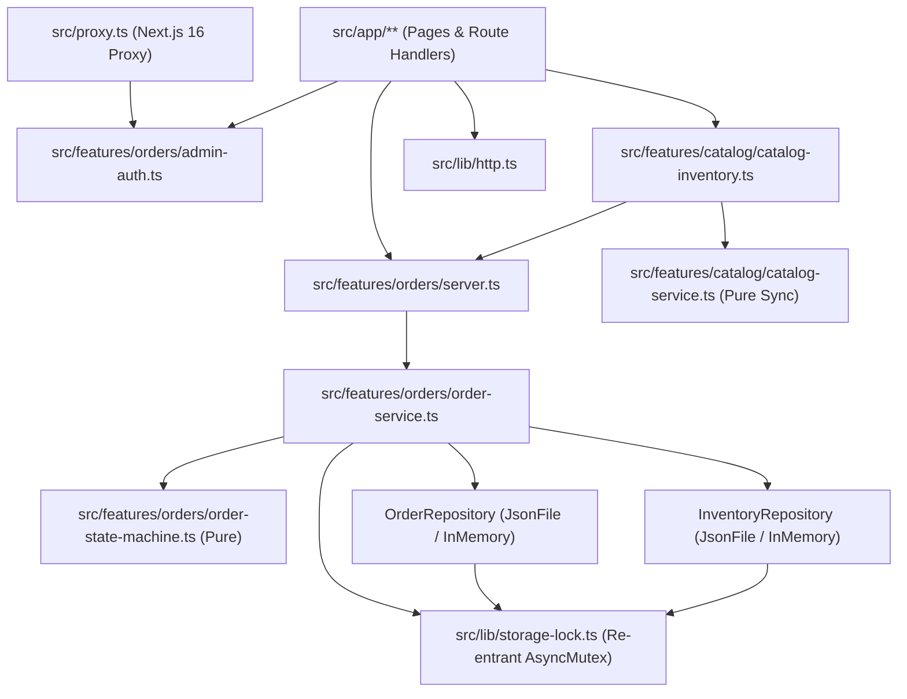
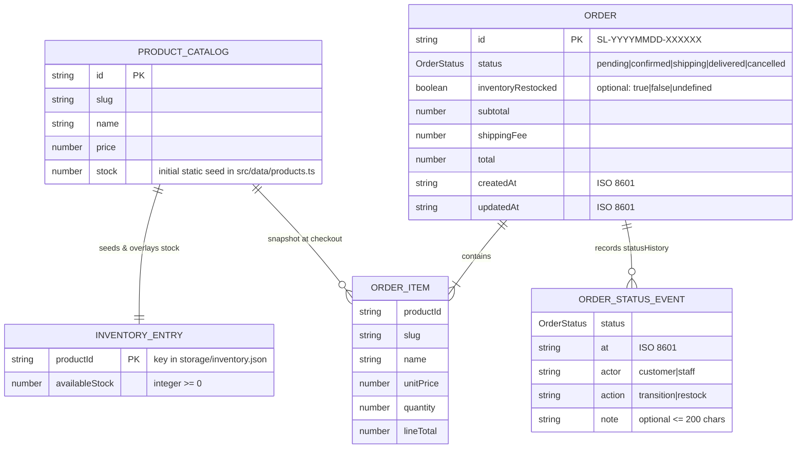
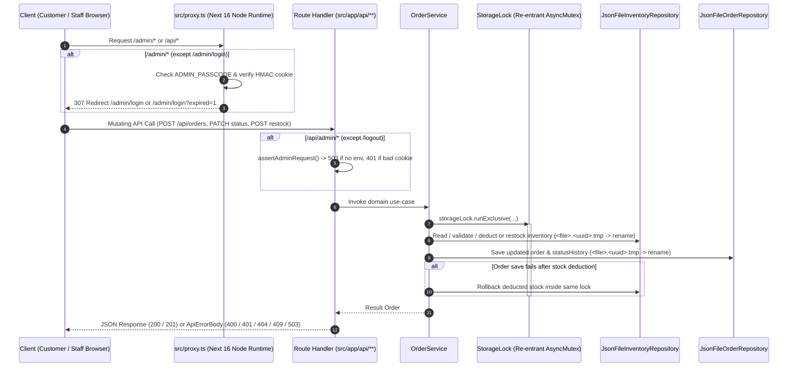

# Architecture Spine — ShopLite Ops

## Design Paradigm

**Feature-Sliced Modular Monolith with Pure Domain Core & Repository Seam** trên Next.js 16 App Router (single-node Node.js runtime, lưu trữ file JSON cục bộ trong `storage/`).

| Lớp kiến trúc (Layer)                              | Ánh xạ thư mục / Module                                                                                                     | Trách nhiệm & Giới hạn                                                                                                                                                                                                                                              |
| ----------------------------------------------------- | ------------------------------------------------------------------------------------------------------------------------------- | ----------------------------------------------------------------------------------------------------------------------------------------------------------------------------------------------------------------------------------------------------------------------- |
| **Routing & Delivery Layer**                    | `src/app/**`, `src/proxy.ts`                                                                                                | Server Components, Route Handlers (`/api/**`), và Next.js 16 Proxy (`src/proxy.ts`). Chỉ parse/validate HTTP request, kiểm tra phiên, gọi Feature Service và render UI / trả `NextResponse`.                                                               |
| **Feature Domain & Application Layer**          | `src/features/<feature>/**` (`orders`, `catalog`, `cart`, `checkout`)                                                 | Lõi nghiệp vụ thuần túy (`order-state-machine.ts`, `pricing.ts`, `cart-reducer.ts`, `catalog-service.ts`), điều phối use-case (`order-service.ts`), xác thực quản trị (`admin-auth.ts`) và React components đặc thù của từng tính năng. |
| **Persistence Adapter Layer (Repository Seam)** | `src/features/orders/order-repository.ts`, `src/features/orders/inventory-repository.ts`, `src/features/orders/server.ts` | Cài đặt giao diện `OrderRepository` và `InventoryRepository` với 2 biến thể song hành: `JsonFile*` (ghi đĩa vào `storage/*.json`) và `InMemory*` (dùng cho unit test), khởi tạo singleton tại `src/features/orders/server.ts`.             |
| **Shared Kernel & Utilities**                   | `src/lib/**`, `src/components/ui/**`, `src/data/products.ts`                                                              | Tiện ích dùng chung không chứa quy tắc miền: `src/lib/storage-lock.ts` (`StorageLock`), `src/lib/http.ts` (`handleRouteError`, `jsonError`, `readJsonBody`), `src/lib/format.ts`, UI primitives và dữ liệu catalog gốc (`PRODUCTS`).         |

## Invariants & Rules



### AD-1 — Phân tách theo tính năng với lõi nghiệp vụ thuần túy tách khỏi Next.js [ADOPTED]

- **Binds:** `all`, `src/features/**`, `src/app/**`
- **Prevents:** Nhúng trực tiếp logic chuyển trạng thái, tính tiền, kiểm tra kho hoặc đọc/ghi file vào React Components hay Route Handlers khiến không thể viết unit test độc lập.
- **Rule:** Các file lõi nghiệp vụ trong `src/features/<feature>/` (`order-state-machine.ts`, `order-service.ts`, `catalog-service.ts`, `pricing.ts`, `cart-reducer.ts`) cấm import từ `next/*` hoặc `react`. Route Handlers trong `src/app/api/**` chỉ được parse request, gọi hàm từ `src/features/**` và trả kết quả qua `NextResponse` / `handleRouteError`.

### AD-2 — Mọi truy cập dữ liệu đơn hàng và tồn kho đi qua Repository Interface có cặp cài đặt JsonFile và InMemory [ADOPTED]

- **Binds:** `FR-5`, `FR-6`, `FR-7`, `src/features/orders/**`
- **Prevents:** Gọi `node:fs` rải rác trong service hoặc route handler, hoặc bắt buộc truyền `inventoryRepository` làm gãy các bài unit test hiện có trong `order-service.test.ts` và `src/app/api/orders/route.test.ts`.
- **Rule:** `OrderService` chỉ phụ thuộc vào interface `OrderRepository` và `InventoryRepository` qua `OrderServiceDeps`. Trong `createOrderService`, tham số `inventoryRepository` phải là tùy chọn và mặc định khởi tạo `createInMemoryInventoryRepository()` (seed từ `PRODUCTS` trong `src/data/products.ts`) để bảo toàn 100% tương thích ngược cho các test chỉ truyền `repository`. Mọi cài đặt trên `OrderRepository` và `InventoryRepository` bắt buộc có đủ cả `JsonFile*` (đọc đường dẫn từ `process.env.ORDERS_FILE` / `process.env.INVENTORY_FILE`) và `InMemory*`, lắp ráp tập trung tại `src/features/orders/server.ts`.

### AD-3 — Server là nguồn chân lý duy nhất về giá và trả lỗi HTTP theo một phong bì chuẩn `ApiErrorBody` [ADOPTED]

- **Binds:** `FR-1`, `FR-2`, `FR-4`, `FR-6`, `FR-7`, `FR-9`, `FR-10`, `src/lib/http.ts`, `src/features/orders/order-errors.ts`, `src/app/api/**`
- **Prevents:** Tin giá/phí ship từ client, trả JSON lỗi tự phát không đồng nhất giữa `/api/orders/*` và `/api/admin/*`, hoặc truyền nhầm số `httpStatus` vào tham số thứ 3 (`details`) của `new OrderError(...)`.
- **Rule:** Giữ nguyên chữ ký constructor 3 tham số `new OrderError(code, message, details?: Record<string, string>)` trong `src/features/orders/order-errors.ts`, trong đó `httpStatus` được tra tự động từ bảng `HTTP_STATUS_BY_CODE[this.code]`. Mở rộng `OrderErrorCode` và `HTTP_STATUS_BY_CODE` gồm đúng 7 mã chuẩn: `VALIDATION_ERROR` (`400`), `UNAUTHORIZED` (`401`), `ORDER_NOT_FOUND` (`404`), `INSUFFICIENT_STOCK` (`409`), `INVALID_STATUS_TRANSITION` (`409`), `PRODUCT_NOT_FOUND` (`422`), và `ADMIN_NOT_CONFIGURED` (`503`). Mọi lỗi trong `/api/**` đều đi qua `handleRouteError(error)` trong `src/lib/http.ts`.

### AD-4 — Máy trạng thái đơn hàng hàm thuần là cổng duy nhất được phép thay đổi `status`, `statusHistory` và `inventoryRestocked`

- **Binds:** `FR-1`, `FR-2`, `FR-3`, `FR-4`, `FR-7`, `FR-15`, `src/features/orders/types.ts`, `src/features/orders/order-state-machine.ts`, `src/features/orders/order-service.ts`
- **Prevents:** Route handler hoặc service tự gán `order.status = ...` làm lọt chuyển đổi nhảy cóc/quay lùi, quên ghi `statusHistory`, hoặc làm hỏng dữ liệu đơn hàng lịch sử không có `statusHistory`.
- **Rule:** Chỉ các hàm thuần trong `src/features/orders/order-state-machine.ts` (`canTransition`, `getAllowedNextStatuses`, `transitionOrder`, `markOrderRestocked`, `synthesizeStatusHistory`) được phép tạo bản ghi `Order` có `status` hoặc `inventoryRestocked` thay đổi. Mọi chuyển đổi trái ma trận 5×5 hoặc lệch `expectedStatus` phải ném `new OrderError("INVALID_STATUS_TRANSITION", ...)`. Khi `actor === "staff"` và `to === "cancelled"`, bắt buộc `note` sau khi `.trim()` có độ dài `1..200` ký tự (sai ném `new OrderError("VALIDATION_ERROR", ...)`). Đơn cũ có `statusHistory === undefined` khi hủy phải đặt `inventoryRestocked = true` nhưng trả `shouldRestock = false` để không cộng khống tồn kho; đơn cũ đã `cancelled` có `inventoryRestocked === undefined` không được phép gọi `markOrderRestocked` (ném `new OrderError("INVALID_STATUS_TRANSITION", ...)`).

### AD-5 — Lưu trữ Tồn kho khả dụng dạng bản đồ phẳng tại `storage/inventory.json`, trừ kho ngay ở `pending` kèm rollback và hoàn kho idempotent

- **Binds:** `FR-2`, `FR-4`, `FR-5`, `FR-6`, `FR-7`, `src/features/orders/inventory-repository.ts`, `src/features/orders/order-service.ts`
- **Prevents:** Bán vượt tồn kho (overselling) khi 2 khách cùng đặt món còn 1 chiếc, lệch tồn kho khi đơn nhiều món bị thiếu ở món cuối, mất tồn kho khi lưu đơn thất bại, hoặc cộng kho 2 lần khi bấm hoàn kho đúp.
- **Rule:** `storage/inventory.json` lưu cấu trúc JSON phẳng `Record<string, number>` ánh xạ `productId` sang số nguyên không âm (`>= 0`). Nếu file hoặc key `productId` chưa tồn tại, `InventoryRepository` tự khởi tạo/fallback từ trường `stock` trong `src/data/products.ts`. Trong `OrderService.placeOrder()`, hệ thống lấy tồn kho thực tế từ `inventoryRepository` (kết hợp thông tin sản phẩm từ `findProduct`), kiểm tra đủ tồn kho cho **tất cả** mặt hàng trước khi trừ (*all-or-nothing*, fail-fast ở mặt hàng thiếu đầu tiên với `new OrderError("INSUFFICIENT_STOCK", ...)`), trừ kho và gọi `repository.save(order)`; nếu `repository.save(order)` ném lỗi, khối `catch` bắt buộc gọi `inventoryRepository.restock(...)` để hoàn trả lại đúng số lượng vừa trừ trước khi ném tiếp lỗi. Khi hủy đơn từ `pending`/`confirmed` (có `statusHistory`), hoàn kho tự động và đặt `inventoryRestocked = true`. Khi hủy đơn từ `shipping`, đặt `inventoryRestocked = false` và giữ nguyên kho; chỉ cộng lại kho đúng 1 lần qua `OrderService.restockCancelledOrder(id, note?)` khi `order.status === "cancelled" && order.inventoryRestocked === false`.

### AD-6 — Tuần tự hóa mọi giao dịch đọc–sửa–ghi bằng `StorageLock` re-entrant dùng chung và ghi đĩa nguyên tử qua file tạm UUID

- **Binds:** `FR-5`, `FR-6`, `FR-7`, `src/lib/storage-lock.ts`, `src/features/orders/order-repository.ts`, `src/features/orders/inventory-repository.ts`, `src/features/orders/order-service.ts`, `src/features/orders/server.ts`
- **Prevents:** Hai request song song cùng đọc `stock = 1` hoặc cùng ghi đè vào một file tạm cố định `.tmp` gây mất đơn, hỏng cú pháp JSON, hoặc deadlock khi `OrderService` giữ khóa rồi gọi xuống Repository cũng giữ khóa.
- **Rule:** Tạo một instance `storageLock = new StorageLock()` duy nhất tại `src/features/orders/server.ts` và truyền vào cả `OrderService`, `createJsonFileOrderRepository(filePath, storageLock)`, và `createJsonFileInventoryRepository(filePath, storageLock)` (tham số `storageLock` ở các hàm factory đều có mặc định `new StorageLock()` để không phá vỡ `order-repository.test.ts`). `StorageLock` (`src/lib/storage-lock.ts`) cài đặt hàng đợi FIFO bất đồng bộ kết hợp `AsyncLocalStorage` (`node:async_hooks`) để đảm bảo tính **re-entrant** (lời gọi `storageLock.runExclusive()` lồng bên trong một giao dịch đã giữ khóa sẽ chạy thẳng không tự khóa chết). Mọi thao tác ghi file JSON trong `JsonFileOrderRepository` và `JsonFileInventoryRepository` bắt buộc ghi vào đường dẫn tạm duy nhất `<filePath>.<crypto.randomUUID()>.tmp` rồi gọi `fs.rename(tmpPath, filePath)` (dọn `fs.unlink` trong `catch` nếu lỗi). `JsonFileOrderRepository` khi đọc/ghi `storage/orders.json` phải giữ tương thích không làm gãy các đơn lịch sử có sẵn trường phụ (`discount`, `couponCode`).

### AD-7 — Giữ nguyên các hàm đọc catalog đồng bộ thuần và cung cấp lớp phủ tồn kho bất đồng bộ cho mặt tiền `force-dynamic`

- **Binds:** `FR-5`, `FR-8`, `src/features/catalog/catalog-service.ts`, `src/features/catalog/catalog-inventory.ts`, `src/app/page.tsx`, `src/app/products/page.tsx`, `src/app/products/[slug]/page.tsx`, `src/app/api/products/route.ts`, `src/app/api/products/[slug]/route.ts`
- **Prevents:** Đổi chữ ký các hàm trong `catalog-service.ts` sang `async` làm gãy toàn bộ 18 unit test hiện có trong `src/features/catalog/catalog-service.test.ts`, hoặc bỏ sót trang chủ `/` và `/products/[slug]` vẫn dùng số tồn tĩnh lúc build.
- **Rule:** Cấm thay đổi chữ ký đồng bộ của các hàm thuần trong `src/features/catalog/catalog-service.ts` (`getAllProducts`, `getFeaturedProducts`, `getProductBySlug`, `getProductById`, `queryProducts`). Tạo module `src/features/catalog/catalog-inventory.ts` kết hợp dữ liệu sản phẩm gốc với `inventoryRepository.getStockMap()` để cung cấp các hàm `async` (`getAllProductsWithStock`, `getFeaturedProductsWithStock`, `queryProductsWithStock`, `getProductBySlugWithStock`, `getProductByIdWithStock`). Bắt buộc khai báo `export const dynamic = "force-dynamic"` trên `src/app/page.tsx`, `src/app/products/page.tsx`, `src/app/products/[slug]/page.tsx` (đồng thời gỡ `generateStaticParams` khỏi `src/app/products/[slug]/page.tsx`) và dùng các hàm `*WithStock` tại cả 3 trang này lẫn `GET /api/products` và `GET /api/products/[slug]`.

### AD-8 — Xác thực quản trị không trạng thái Fail-Closed (`503 → 401`) dùng chung một module `admin-auth.ts` cho cả Next.js 16 `src/proxy.ts` và `/api/admin/*`

- **Binds:** `FR-9`, `FR-10`, `FR-11`, `src/features/orders/admin-auth.ts`, `src/proxy.ts`, `src/app/admin/**`, `src/app/api/admin/**`
- **Prevents:** Lệch thuật toán ký/kiểm tra cookie giữa tầng điều hướng trang và tầng API, lộ API `/api/admin/*` khi gọi trực tiếp bằng `curl`, ném lỗi `RangeError` (`500`) khi so sánh mật khẩu khác độ dài byte bằng `crypto.timingSafeEqual`, hoặc cấu hình sai `runtime` trong `src/proxy.ts` của Next.js 16.
- **Rule:** Toàn bộ logic mật khẩu và phiên quản trị đặt tại `src/features/orders/admin-auth.ts`:
  1. Kiểm tra `process.env.ADMIN_PASSCODE?.trim()`: nếu thiếu hoặc rỗng, luôn ưu tiên ném `new OrderError("ADMIN_NOT_CONFIGURED", ...)` (`503`) **trước** mọi bước kiểm tra cookie hay body.
  2. So sánh mật khẩu bằng cách băm `SHA-256` (32 byte) cả chuỗi nhập vào lẫn `ADMIN_PASSCODE` rồi gọi `crypto.timingSafeEqual(a, b)` (sai ném `new OrderError("UNAUTHORIZED", ...)` `401`).
  3. Cookie phiên có tên cố định `shoplite_admin`, thời hạn `Max-Age=28800` (8 giờ), thuộc tính `HttpOnly; SameSite=Lax; Path=/` (thêm `Secure` khi `process.env.NODE_ENV === "production"`), giá trị có định dạng `<expiresAtEpochMs>.<hmacSha256Hex>` với chữ ký `HMAC-SHA256` trên chuỗi `"shoplite_admin:" + expiresAtEpochMs` dùng khóa `ADMIN_PASSCODE.trim()` và kiểm tra chữ ký bằng `crypto.timingSafeEqual`.
  4. Tầng trang `/admin/*`: file `src/proxy.ts` xuất hàm `export function proxy(request: NextRequest)` và `export const config = { matcher: ["/admin/:path*"] }` (tuyệt đối **không** khai báo `export const runtime` theo quy định của Next.js 16). Với mọi truy cập `/admin/*` khác `/admin/login`: nếu thiếu `ADMIN_PASSCODE` hoặc chưa có cookie `shoplite_admin` thì chuyển hướng (`307`) về `/admin/login`; nếu đã có cookie `shoplite_admin` nhưng hết hạn hoặc sai chữ ký thì chuyển hướng (`307`) về `/admin/login?expired=1`.
  5. Tầng API `/api/admin/*`: mọi route handler (trừ `POST /api/admin/auth/login` chỉ kiểm tra `503` trước khi xác thực mật khẩu, và `POST /api/admin/auth/logout` luôn trả `200` xóa cookie `Max-Age=0`) bắt buộc gọi `assertAdminRequest(request)` ở dòng đầu tiên để ném `OrderError` (`503` hoặc `401`).

### AD-9 — Hợp đồng hàng chờ quản trị một lượt tải kèm đếm tab, sắp xếp FIFO cho `pending`, và khóa lạc quan `expectedStatus`

- **Binds:** `FR-1`, `FR-12`, `FR-13`, `FR-14`, `src/features/orders/order-service.ts`, `src/app/api/admin/orders/**`, `src/app/admin/orders/**`
- **Prevents:** Client và server tính lệch số lượng badge trên các tab lọc khi đang lọc một trạng thái, hiển thị sai thứ tự ưu tiên xử lý đơn `pending`, hoặc hai nhân viên mở hai tab ghi đè trạng thái của nhau.
- **Rule:** `GET /api/admin/orders?status=&q=` gọi `orderService.listAdminOrders(filter)` trả về cùng lúc 3 trường trong một JSON response: `orders` (đã lọc theo `q` qua `normalizeText` trên mã đơn, SĐT, tên khách và lọc theo `status`, trong đó `status` không hợp lệ tự fallback về `"all"`), `counts` (bản đồ đếm số lượng đơn của cả 5 trạng thái cộng `"all"`, tính trên tập đơn đã khớp từ khóa `q` trước khi cắt theo tab `status`), và `availableStockByProductId` (snapshot tồn kho hiện tại từ `InventoryRepository`). Khi `status === "pending"`, mảng `orders` sắp xếp theo `createdAt` **tăng dần (FIFO — đơn cũ nhất lên đầu)**; mọi tab khác sắp xếp theo `createdAt` giảm dần (mới nhất lên đầu). Giao diện `/admin/orders` bắt buộc gửi kèm `expectedStatus: order.status` trong mọi request `PATCH /api/admin/orders/:id/status`.

### AD-10 — Khóa cứng hợp đồng chữ ký TypeScript tại ranh giới giữa các module (`StorageLock`, `InventoryRepository`, `order-state-machine`, `OrderService`, `admin-auth`)

- **Binds:** `FR-1`, `FR-2`, `FR-3`, `FR-4`, `FR-5`, `FR-6`, `FR-7`, `FR-9`, `FR-10`, `FR-11`, `FR-12`, `src/lib/storage-lock.ts`, `src/features/orders/**`, `src/features/catalog/catalog-inventory.ts`
- **Prevents:** Hai Story độc lập đặt tên hàm hoặc kiểu tham số/trả về khác nhau (ví dụ `getAvailableStock` vs `getStock`, `updateStatus` vs `transitionOrderStatus`) gây lỗi compile khi ghép nối.
- **Rule:** Toàn bộ các Story triển khai `StorageLock`, `InventoryRepository`, `order-state-machine.ts`, `OrderService` và `admin-auth.ts` bắt buộc tuân thủ chính xác tên hàm, tham số và kiểu trả về được định nghĩa tại mục **Structural Seed §3 (TypeScript Seam Contracts)** của tài liệu này.

## Consistency Conventions

| Mối quan tâm (Concern)                                        | Quy ước bắt buộc (Convention)                                                                                                                                                                                                                                                                                                                                                                                                                                                                                                                   |
| --------------------------------------------------------------- | --------------------------------------------------------------------------------------------------------------------------------------------------------------------------------------------------------------------------------------------------------------------------------------------------------------------------------------------------------------------------------------------------------------------------------------------------------------------------------------------------------------------------------------------------- |
| **Đặt tên file & ký hiệu**                           | Tên file dùng `kebab-case.ts` / `.tsx`; React component và kiểu TypeScript dùng `PascalCase`; hàm và biến dùng `camelCase`; hằng số cấu hình dùng `UPPER_SNAKE_CASE`.                                                                                                                                                                                                                                                                                                                                                       |
| **Định danh & Thời gian**                              | Mã đơn hàng giữ định dạng `SL-YYYYMMDD-XXXXXX`; toàn bộ dấu thời gian (`createdAt`, `updatedAt`, `OrderStatusEvent.at`) dùng chuỗi ISO 8601 UTC (`new Date().toISOString()`); hiển thị UI qua `formatDateTime()` và `formatCurrency()` trong `src/lib/format.ts`.                                                                                                                                                                                                                                                  |
| **Cấu trúc sự kiện lịch sử (`OrderStatusEvent`)** | Mỗi phần tử trong `order.statusHistory` gồm: `status` (`OrderStatus`), `at` (ISO 8601), `actor` (`"customer" \| "staff"`), `action` (`"transition" \| "restock"`), và `note?` (chuỗi đã `.trim()`, dài `1..200` ký tự, chỉ có mặt khi khác rỗng).                                                                                                                                                                                                                                                               |
| **Hợp đồng HTTP & Parse Body**                         | Mọi đọc body JSON trong Route Handler đi qua `readJsonBody(request)` (`src/lib/http.ts`). `POST /api/admin/auth/login` và `PATCH /api/admin/orders/:id/status` bắt buộc có body JSON hợp lệ (`400 VALIDATION_ERROR` nếu `undefined`); `POST /api/admin/orders/:id/restock` chấp nhận body rỗng (`request.text()` rỗng) **hoặc** JSON hợp lệ có `note?: string` (`<= 200` ký tự); `POST /api/admin/auth/logout` không đọc body.                                                                  |
| **UI, Trợ năng & Xử lý lỗi Client**                  | Tuân thủ đúng token Tailwind v4 và quy tắc hành vi trong `DESIGN.md` & `EXPERIENCE.md`: vùng chạm tối thiểu `min-h-11` (`44px`), không tràn ngang ở `390px`, ghép đủ **màu + icon `lucide-react` + văn bản** cho mọi trạng thái. Khi `/checkout` nhận `409 INSUFFICIENT_STOCK`, giữ nguyên state form địa chỉ và giỏ hàng. Khi `/admin/orders` nhận `401`, điều hướng sang `/admin/login?expired=1`; khi nhận `409`, hiện `role="alert"` và tự tải lại danh sách đơn. |
| **Biến môi trường & Chạy Local** | Toàn bộ hệ thống chạy độc lập 100% trên máy local (`http://localhost:3000` qua `npm run dev` hoặc `npm run build && npm run start`), không phụ thuộc DB hay dịch vụ đám mây. Cấu hình qua `.env.local` hoặc biến môi trường shell: `ORDERS_FILE` (mặc định `storage/orders.json`), `INVENTORY_FILE` (mặc định `storage/inventory.json`), `ADMIN_PASSCODE` (bắt buộc phải khác rỗng để mở cổng `/admin/*` và `/api/admin/*`, không có giá trị fallback trong code). |
| **Test Seam & Cô lập dữ liệu** | Unit test của service/state-machine dùng `InMemoryOrderRepository` + `InMemoryInventoryRepository`; test của `JsonFile*Repository` và route test tạo thư mục tạm riêng trong `os.tmpdir()` hoặc truyền `ORDERS_FILE` / `INVENTORY_FILE` riêng, không ghi bẩn vào `storage/` thật. |

## Stack

| Name | Version |
| --- | --- |
| Local Execution Environment (Single-Node `localhost:3000`, zero external DB/cloud) | `Node.js 22.23.4` (`>=22.12.0`) |
| Local Persistence (`node:fs/promises` + atomic UUID `.tmp` JSON files in `storage/`) | `Node.js 22.23.4 built-in` |
| Concurrency & Re-entrant Mutex (`node:async_hooks` `AsyncLocalStorage` + FIFO Queue) | `Node.js 22.23.4 built-in` |
| Auth & Cryptography (`node:crypto` `SHA-256`, `HMAC-SHA256`, `timingSafeEqual`) | `Node.js 22.23.4 built-in` |
| TypeScript | `5.9.3` |
| Next.js (App Router + `src/proxy.ts` Node Runtime) | `16.4.2` |
| React / React DOM | `19.3.0` |
| Tailwind CSS (`@tailwindcss/turbopack`) | `4.3.3` |
| Zod | `4.6.7` |
| Lucide React | `1.61.0` |
| clsx | `2.1.1` |
| Vitest / `@vitest/coverage-v8` | `5.0.5` |
| Testing Library (`@testing-library/react`) | `16.3.3` |
| Playwright (`@playwright/test` — Local Chromium E2E) | `1.64.1` |
| ESLint / `eslint-config-next` | `9.x` / `16.4.2` |
| Prettier / `prettier-plugin-tailwindcss` | `3.9.10` / `0.8.1` |

## Structural Seed

### 1. Sơ đồ thực thể & Quan hệ dữ liệu (Core Entity ERD)



### 2. Sơ đồ luồng giao dịch & Môi trường vận hành (Single-Node Runtime Envelope)



### 3. Hợp đồng chữ ký TypeScript liên module (TypeScript Seam Contracts — AD-10)

```ts
// 1. src/lib/storage-lock.ts
export class StorageLock {
  runExclusive<T>(fn: () => Promise<T>): Promise<T>;
}

// 2. src/features/orders/types.ts (additions)
export type OrderActor = "customer" | "staff";
export type OrderHistoryAction = "transition" | "restock";

export interface OrderStatusEvent {
  status: OrderStatus;
  at: string;
  actor: OrderActor;
  action: OrderHistoryAction;
  note?: string;
}

// Order interface additions:
//   statusHistory?: OrderStatusEvent[];
//   inventoryRestocked?: boolean;

// 3. src/features/orders/order-state-machine.ts
export interface TransitionOrderInput {
  to: OrderStatus;
  actor: OrderActor;
  now?: Date;
  note?: string;
  expectedStatus?: OrderStatus;
}

export interface TransitionOrderResult {
  order: Order;
  shouldRestock: boolean;
}

export function canTransition(from: OrderStatus, to: OrderStatus, actor: OrderActor): boolean;
export function getAllowedNextStatuses(from: OrderStatus, actor: OrderActor): OrderStatus[];
export function transitionOrder(order: Order, input: TransitionOrderInput): TransitionOrderResult;
export function markOrderRestocked(order: Order, input?: { now?: Date; note?: string }): Order;
export function synthesizeStatusHistory(order: Order): OrderStatusEvent[];

// 4. src/features/orders/inventory-repository.ts
export interface InventoryRepository {
  getStockMap(): Promise<Record<string, number>>;
  getStock(productId: string): Promise<number>;
  deduct(items: { productId: string; quantity: number }[]): Promise<void>;
  restock(items: { productId: string; quantity: number }[]): Promise<void>;
}

export function createJsonFileInventoryRepository(
  filePath: string,
  storageLock?: StorageLock,
): InventoryRepository;
export function createInMemoryInventoryRepository(
  seed?: Record<string, number>,
): InventoryRepository;

// 5. src/features/orders/order-service.ts (extended OrderServiceDeps & methods)
export interface AdminOrderListFilter {
  status?: string;
  q?: string;
}

export interface AdminOrderListResult {
  orders: Order[];
  counts: Record<OrderStatus | "all", number>;
  availableStockByProductId: Record<string, number>;
}

// Extended methods on OrderService:
//   transitionOrderStatus(id: string, input: { status: OrderStatus; actor: OrderActor; note?: string; expectedStatus?: OrderStatus }): Promise<Order>;
//   restockCancelledOrder(id: string, note?: string): Promise<Order>;
//   listAdminOrders(filter?: AdminOrderListFilter): Promise<AdminOrderListResult>;

// 6. src/features/orders/admin-auth.ts
export const ADMIN_COOKIE_NAME = "shoplite_admin";
export const ADMIN_SESSION_TTL_SECONDS = 28_800;

export function isAdminConfigured(): boolean;
export function verifyAdminPasscode(inputPasscode: string): void; // throws OrderError(503 | 401)
export function createAdminSessionToken(nowMs?: number): string;   // throws OrderError(503)
export function verifyAdminSessionToken(token: string | undefined, nowMs?: number): "valid" | "expired" | "missing" | "unconfigured";
export function assertAdminRequest(request: Request): void;        // throws OrderError(503 | 401)
```

### 4. Cây thư mục mục tiêu (Minimal Source Tree Delta)

```text
shoplite/
  src/
    proxy.ts                                         # [NEW] Next.js 16 Proxy bảo vệ /admin/* (trừ /admin/login)
    lib/
      http.ts                                        # [EXISTING] ApiErrorBody, jsonError, handleRouteError, readJsonBody
      format.ts                                      # [EXISTING] formatCurrency, formatDateTime, normalizeText
      storage-lock.ts                                # [NEW] StorageLock (re-entrant AsyncMutex với AsyncLocalStorage)
    features/
      catalog/
        catalog-service.ts                           # [EXISTING] Giữ nguyên các hàm sync thuần
        catalog-inventory.ts                         # [NEW] Async helpers phủ tồn kho động từ InventoryRepository
      orders/
        types.ts                                     # [MODIFIED] Thêm OrderStatusEvent, statusHistory?, inventoryRestocked?
        order-errors.ts                              # [MODIFIED] Thêm UNAUTHORIZED (401), ADMIN_NOT_CONFIGURED (503)
        order-state-machine.ts                       # [NEW] Hàm thuần canTransition, transitionOrder, markOrderRestocked, synthesizeStatusHistory
        inventory-repository.ts                      # [NEW] InventoryRepository interface + JsonFileInventoryRepository + InMemoryInventoryRepository
        order-repository.ts                          # [MODIFIED] Dùng StorageLock + file tạm UUID + bảo toàn trường đơn cũ
        order-service.ts                             # [MODIFIED] Trừ kho nguyên tử + rollback, transitionOrderStatus, restockCancelledOrder, listAdminOrders
        admin-auth.ts                                # [NEW] Kiểm tra ADMIN_PASSCODE (503), timingSafeEqual SHA-256, ký/verify cookie HMAC-SHA256
        server.ts                                    # [MODIFIED] Khởi tạo singleton storageLock, inventoryRepository, orderRepository, orderService
        components/
          order-status-badge.tsx                     # [MODIFIED] Nâng tương phản cancelled (text-slate-600) + gắn icon lucide-react
          cancel-order-button.tsx                    # [MODIFIED] Tự gọi router.refresh() khi gặp 409
          order-progress-timeline.tsx                # [NEW] OrderProgressTimeline 4 bước + fallback đơn cũ
          refresh-status-button.tsx                  # [NEW] RefreshStatusButton (router.refresh)
          admin-header-bar.tsx                       # [NEW] AdminHeaderBar + nút Đăng xuất
          admin-login-card.tsx                       # [NEW] AdminLoginCard (hiển thị 503 / expired / login form)
          admin-orders-view.tsx                      # [NEW] OrderFilterTabs, AdminOrderSearchBar, AdminOrderCard, ReservedStockIndicator, RestockStatusBadge, CancelOrderDialog
    app/
      page.tsx                                       # [MODIFIED] force-dynamic + getFeaturedProductsWithStock
      products/
        page.tsx                                     # [MODIFIED] force-dynamic + queryProductsWithStock
        [slug]/page.tsx                              # [MODIFIED] force-dynamic (gỡ generateStaticParams) + getProductBySlugWithStock
      orders/
        [id]/page.tsx                                # [MODIFIED] Tích hợp OrderProgressTimeline + RefreshStatusButton + hướng dẫn khi khác pending
      admin/
        login/page.tsx                               # [NEW] Trang đăng nhập quản trị (Server Component kiểm tra sẵn ADMIN_PASSCODE)
        orders/page.tsx                              # [NEW] Trang cổng vận hành đơn hàng /admin/orders
      api/
        products/
          route.ts                                   # [MODIFIED] Đọc stock động qua queryProductsWithStock
          [slug]/route.ts                            # [MODIFIED] Đọc stock động qua getProductBySlugWithStock
        orders/
          route.ts                                   # [EXISTING] GET / POST đơn hàng khách
          [id]/route.ts                              # [EXISTING] GET / PATCH khách tự hủy đơn pending (tích hợp hoàn kho qua OrderService)
        admin/
          auth/
            login/route.ts                           # [NEW] POST đăng nhập phát cookie shoplite_admin
            logout/route.ts                          # [NEW] POST đăng xuất xóa cookie shoplite_admin
          orders/
            route.ts                                 # [NEW] GET danh sách đơn + counts + availableStockByProductId
            [id]/
              status/route.ts                        # [NEW] PATCH chuyển trạng thái / hủy đơn có lý do + expectedStatus
              restock/route.ts                       # [NEW] POST xác nhận nhận hàng hoàn (+kho) 1 lần cho đơn hủy từ shipping
  storage/
    orders.json                                      # [EXISTING] Lưu trữ đơn hàng
    inventory.json                                   # [NEW AT RUNTIME] Lưu trữ tồn kho khả dụng Record<productId, number>
```

## Capability → Architecture Map

| Yêu cầu (FR / Invariant)                                                                                                                                        | Nằm tại Module / Route                                                                                                                                       | Bị ràng buộc bởi                                                  |
| ----------------------------------------------------------------------------------------------------------------------------------------------------------------- | -------------------------------------------------------------------------------------------------------------------------------------------------------------- | --------------------------------------------------------------------- |
| **FR-1:** Chuyển trạng thái đơn hàng theo ma trận 5×5 + `expectedStatus`                                                                          | `src/features/orders/order-state-machine.ts`, `src/features/orders/order-service.ts`, `src/app/api/admin/orders/[id]/status/route.ts`                    | `AD-1`, `AD-3`, `AD-4`, `AD-6`, `AD-8`, `AD-9`, `AD-10` |
| **FR-2:** Nhân viên hủy đơn `pending`/`confirmed`/`shipping` kèm lý do bắt buộc                                                              | `src/features/orders/order-state-machine.ts`, `src/features/orders/order-service.ts`, `src/app/api/admin/orders/[id]/status/route.ts`                    | `AD-3`, `AD-4`, `AD-5`, `AD-6`, `AD-8`, `AD-10`           |
| **FR-3:** Ghi nhận `statusHistory` bất biến & tương thích ngược đơn cũ                                                                         | `src/features/orders/types.ts`, `src/features/orders/order-state-machine.ts`, `src/features/orders/order-repository.ts`                                  | `AD-2`, `AD-4`, `AD-5`, `AD-6`, `AD-10`                     |
| **FR-4:** Khách hàng tự hủy đơn khi còn `pending` (`PATCH /api/orders/:id`)                                                                      | `src/app/api/orders/[id]/route.ts`, `src/features/orders/order-service.ts`                                                                                 | `AD-3`, `AD-4`, `AD-5`, `AD-6`, `AD-10`                     |
| **FR-5:** Khởi tạo & lưu trữ Tồn kho khả dụng tại `storage/inventory.json`                                                                        | `src/features/orders/inventory-repository.ts`, `src/features/orders/server.ts`                                                                             | `AD-2`, `AD-5`, `AD-6`, `AD-10`                               |
| **FR-6:** Trừ kho nguyên tử lúc đặt hàng (`pending`), all-or-nothing & rollback                                                                    | `src/features/orders/order-service.ts`, `src/lib/storage-lock.ts`                                                                                          | `AD-2`, `AD-3`, `AD-5`, `AD-6`, `AD-7`, `AD-10`           |
| **FR-7:** Hoàn kho idempotent & xác nhận nhận hàng hoàn từ `shipping` (`POST .../restock`)                                                       | `src/features/orders/order-service.ts`, `src/app/api/admin/orders/[id]/restock/route.ts`                                                                   | `AD-3`, `AD-4`, `AD-5`, `AD-6`, `AD-8`, `AD-10`           |
| **FR-8:** Đồng bộ Tồn kho khả dụng động lên `/`, `/products`, `/products/[slug]`, `/api/products*`, `/checkout`                          | `src/features/catalog/catalog-inventory.ts`, `src/app/page.tsx`, `src/app/products/**`, `src/app/api/products/**`                                      | `AD-1`, `AD-5`, `AD-7`, `AD-10`                               |
| **FR-9, FR-10, FR-11:** Bảo vệ `/admin/*` & `/api/admin/*` Fail-Closed (`503 → 401`) + Đăng xuất                                                | `src/features/orders/admin-auth.ts`, `src/proxy.ts`, `src/app/admin/login/page.tsx`, `src/app/api/admin/auth/**`                                       | `AD-3`, `AD-8`, `AD-10`                                         |
| **FR-12, FR-13, FR-14:** Cổng vận hành `/admin/orders` (lọc URL, đếm tab, FIFO `pending`, tồn kho giữ chỗ inline, hộp thoại hủy, hoàn kho) | `src/app/admin/orders/page.tsx`, `src/features/orders/components/admin-orders-view.tsx`, `src/app/api/admin/orders/route.ts`                             | `AD-1`, `AD-4`, `AD-5`, `AD-8`, `AD-9`, `AD-10`           |
| **FR-15:** Timeline tiến trình 4 bước & nút Làm mới thủ công tại `/orders/[id]`                                                                 | `src/app/orders/[id]/page.tsx`, `src/features/orders/components/order-progress-timeline.tsx`, `src/features/orders/components/refresh-status-button.tsx` | `AD-1`, `AD-4`, `AD-10`                                         |

## Deferred

1. **Chuyển từ lưu trữ file JSON sang cơ sở dữ liệu quan hệ (PostgreSQL / SQLite) và khóa phân tán đa tiến trình (Multi-instance lock):** Hoãn sang v2 vì quy mô MVP chạy trên một tiến trình Node.js duy nhất (`<= 500` đơn hàng); giao diện `OrderRepository` và `InventoryRepository` (`AD-2`) đã cô lập hoàn toàn tầng lưu trữ để thay thế mà không sửa `OrderService`.
2. **Thu hồi phiên quản trị phía server (Server-side session revocation store) và phân quyền đa tài khoản (RBAC):** Hoãn sang v2; ở v1 chấp nhận cookie `HMAC-SHA256` không trạng thái (`AD-8`) trong đó đổi `ADMIN_PASSCODE` sẽ thu hồi toàn bộ phiên đang mở và Đăng xuất xóa cookie trình duyệt.
3. **Riêng tư hóa danh sách `/orders` công khai và tra cứu đơn bằng SĐT có rate-limit bền vững:** Hoãn sang một initiative độc lập sau MVP để giữ nguyên hợp đồng `e2e/shopping-flow.spec.ts` hiện có và đợi hạ tầng lưu trữ rate-limit không mất khi khởi động lại.
4. **Phân trang danh sách đơn hàng (`> 500` đơn), thẻ KPI tổng quan và cảnh báo SLA đơn chờ quá 2 giờ:** Hoãn sang v1.1 khi lưu lượng đơn chờ vượt ngưỡng ~30 đơn/ngày.
